# Dračí nezavislost.one (On 01.03.2023)

> Extracted from OneNote backup via UTF-16LE string scan. Review before promoting to canon.

## Images

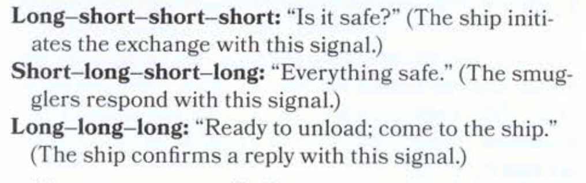

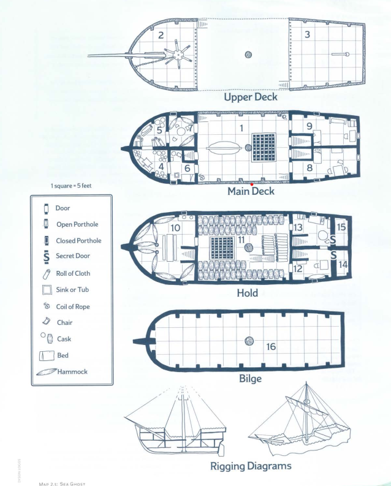

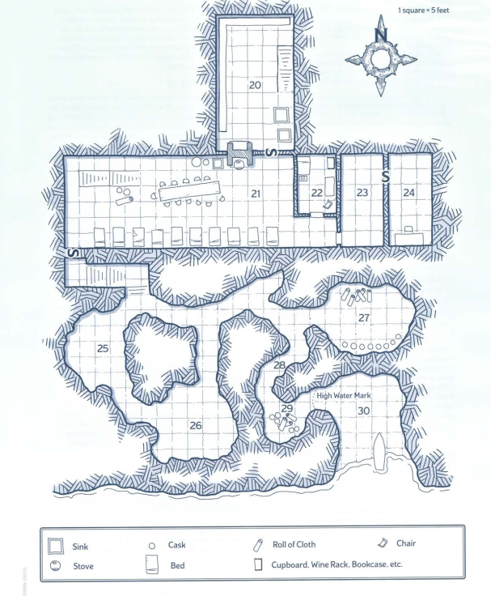

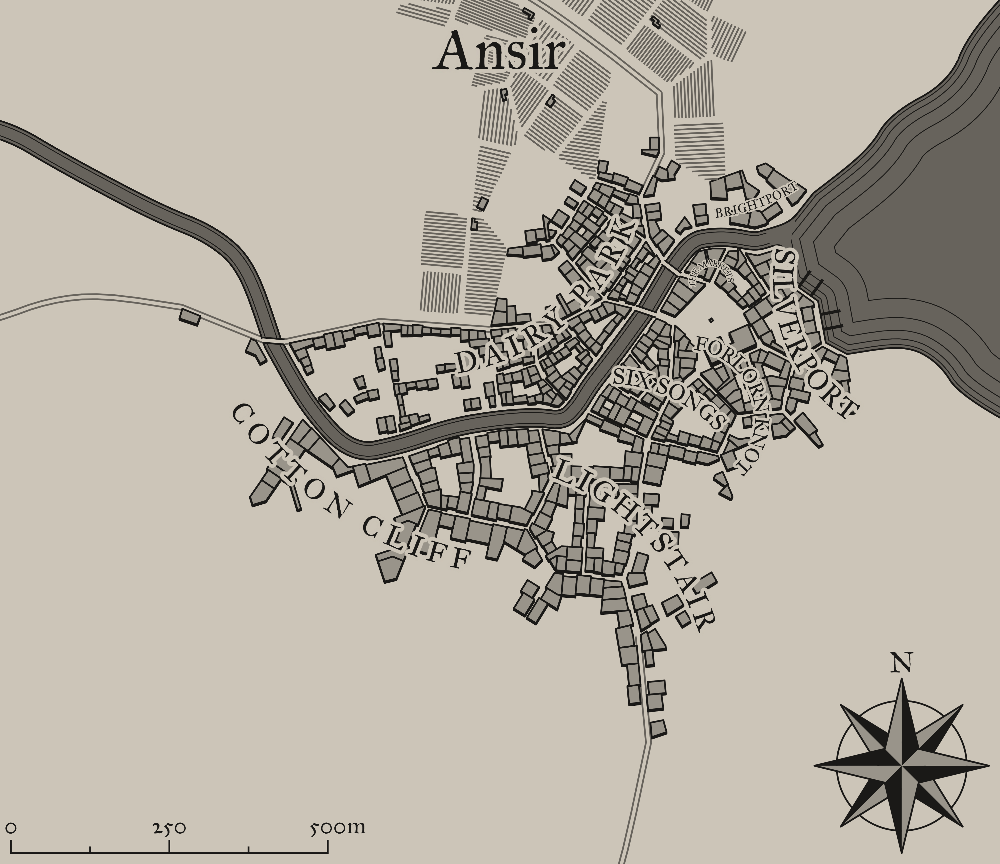

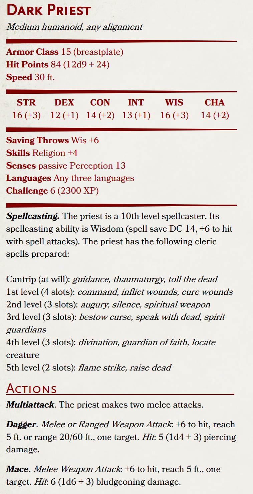

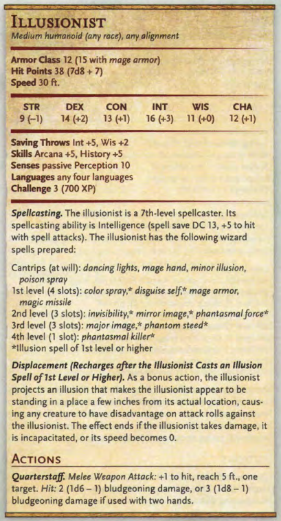

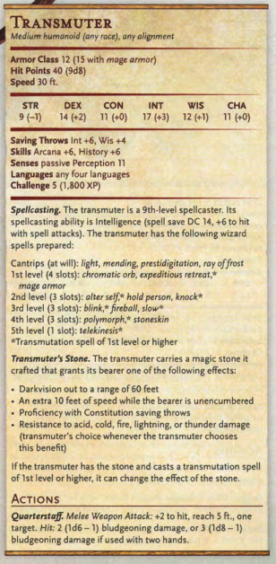

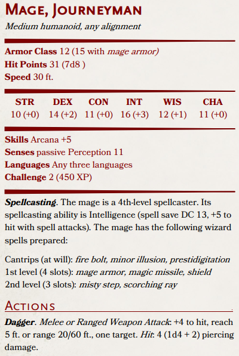

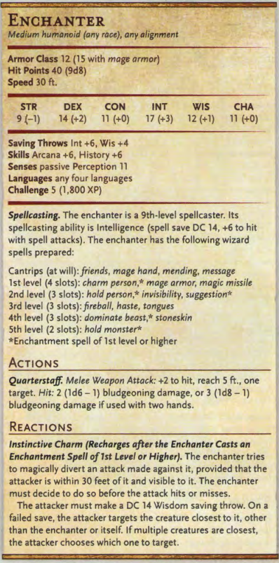

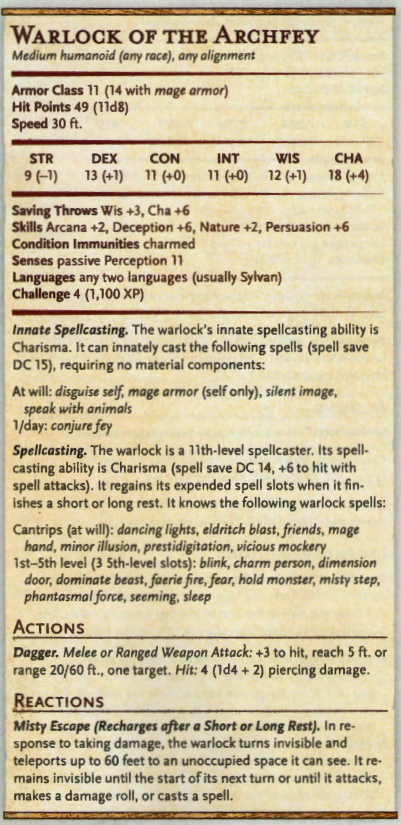

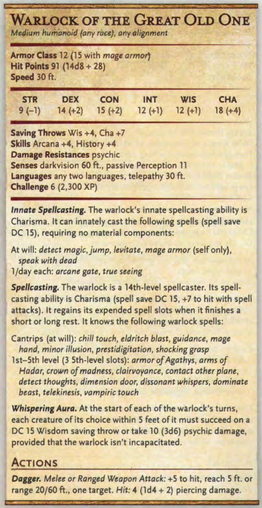

## Content

- Adventure template
- Monsters
- Harry Mansion
- Korzárská republika
- Mokrá lhota
- Saltmarsh
- Act III
- Old notes
- Pirates
- Act II
- Master plot
- Region
- Undead
- Saurines
- Constructs
- DM Notes
- Bandits
- Random
- Info ke hraní
- Dragonborns
- Trojkoalice svobodných republik korzárských
- Taubers
- Beasts
- Next session
- Ā6Ā0Ā4Ā/Ā5Ā'Ā&Ā)Ā
- Ā7Ā8Ā9Ā:Ā;Ā<Ā=Ā>Ā?Ā@ĀAĀB
- Sea Ghost
- Jan Jašek
- Nastěnka - kulišova oblíbenkyně
- Calibri
- Tomáš a Vasil - strážní co utekly ze služby
- Tvígo - Friedrichův žebrák
- PageTitle
- Calibri Light
- PageDateTime
- Přeživší z puče zemřel 3 dny pred Drevolhotou
Prcek a Třesavec přijíždějí v noci během událostí v Dřevolhotě doprovázeni Arrynovými muži

Kuliš umírá a zbraně zbrane jsou ukradeny 1. Noc po udalostech v Drevolhote. Drsonovi muži odjíždějí.

Během večera potkali v Lokále Prcka a Errynovy muže a když se prokecli o nákladu zbraní, usoudili, že je správný čas pobrat co půjde a zmizet

- Wingdings
Uspořádali v Lokálu velikou akci, na kterou nalákali ostatní vojáky, přidali se I Tomáš a Vasil, kteří měli hlídat v pevnosti

Zatímco se část vojáků přesunula veselit do bordelu, zbytek vzal Prcka a opilého ho přesvědčili, aby se k nim přidal. Ten je dovedl k vozu, kde zabili Třesavce

Druhá část pronikla do pevnosti, kde do připravených naolejovaných kůží naložili cenné zbraně a spustili je podél stěny k řece, kde je na malém prámu táhli proti proudu až k cestě, kde je přidali ke zbraním na voze a ještě v noci vyrazili do Mokré Lhoty

- Po tom co se oznami si je privola Stoupač
- Stoupač odjíždí zpátky na frontu pronásledovat čarodějku 2. dne ráno
- Hemmond umírá večer 3. Dne a nahrazuje jej ve velení kapitán Kaplan
- Friedrich si hráče povolá na večer 4. dne
- S Nasťou mají domluvený rozhovor dopoledne 4. dne
- Courier New
V bývalých stájích ring pro noční zápasy - dnes temnooky Muhad proti Dragonbornovi

- Alastor poznán jedním z místních císařských štamgastů
Dva mrtví strážní + Mel, několik desítek zraněných, pár mrtvých děcek a místních vidláků

- Zapálené domy na druhé straně města
- Půltucet pobytých domorodců
Farmář provinilý krádeží vojenského proviantu, kteří předtím vesnici ukradli vojáci Stoupače

- Fanatik Tříštivého proudu, kultu proklamujícího konec světa
- Jeden z těch Démonských - magic user - spálené dva domy na kraji vesnice
- Vypravěč příběhů -
Lovec míšenec Kerr, který potkal hromadu spálených a shnilých mrtvol v kráteru ohně, dle jeho názoru to způsobile En'ther - čarodejnice z pověstí domorodců

- Syn Miloše ňoumy
- Stoupač odjíždí zpátky na frontu pronásledovat čarodějku
- pondělí 10. října 2022
Otec Jimmyho Danty - koželuh, žije sám a truchlí pro své dva mrtvé syny, nabídne hráčům za odměnu Jimmyho prsten, pokud zjistí, co se stalo s jeho posledním synem

- Hemmond umírá den po příjezdu, zabit ve spánku krvavou magií
- Dřevopole
- Dorazí tam na večer, ideální místo k utáboření
- Fido shání felčara - otrava krve jednoho z jeho mužů - restoration
- Zmlácená servírka Nina a několik dalších -> způsobuje místní voják Mel
- Místní obchodník s chudobou Friedrich ví, že Kuliš měl své pletky s Drsoň
- Na rynku 3 lidé vsazení do planýře a několik temnookých naražených na kůly
- Hemmond umírá večer 3. Dne
Encounter s Frederikem - Dovedeni do uzlů, kde jsou vyzváni k odevzdáni zbraní a potom vedeni tmou poměrně dlouho a zmatečně, než jsou posazeni před Frederika - ten po nich chce zabít Harryho

- Místní obchodník s chudobou Friedrich ví, že Kuliš měl své pletky s Rotgarem
- Přepadení Yasmine
Encounter s cílem zabití Charlese - odvedení pozornosti a přepadení v jedné z uliček

Zabití Hemonda, našla ho jeho mladá služka (sotva děvčátko) - podobná holčina nosila jídlo vězni

- Encounter s podsvětím - žebrák Tvígo si všimne Perinova vyptávání
- Hemmond umírá večer 3. Dne a nahrazuje jej ve velení kapitán
- Se bavil s Prckem a Arrynovými muži dříve, než ses přidali muži z Mokré Lhoty
Kníratý vůdce si nechával říkat Tormund, v době, kdy se přidali, už byl Hansen I ostatní značně podnapilý a příliš si toho nepamatuje.

- Zmínili se o voze, který nechali stranou města pod dohledem jejich společníka
- Zmínili se, že si chtěli dát den voraz než se přihlásí do aktivní služby
Osloví hráče V Lokále s tím, že ví, kam vojáci odešli a nabídne jim, že je za nimi zavede

- Cestou je na ně z boční uličky hozen molotov
Harryho údajně neviděli na veřejnosti již několik týdnů. Chvíli po puči byl ještě v radě a rezolutně odmítal, že by byl v přepadení nějak zapojený

- Od té doby jej z rady chodíval omluvit jeho sluha s tím, že pán ochořel
- Není vidět ani jeho rodinu
- Jeho osobní ochranka taktéž nevylezla z domu
Zásoby chodí nakupovat služebnictvo, kteří jsou jako uhranutí a odmítají cokoliv povědět

- Kulišovy texty
Je tam sada textů, která kopíruje určitý vzor, a po určité době jsou schopný rozlišit, že se jedná o zprávy typu. Dnešní předávka proběhla úspěšně, předáno bylo 67 mečů a různých dalších kusů zbroje nebo zbraní.

Druhou sadu textů, je prakticky nemožné přeložit texty, protože žádný vzor neobsahují a kombinace slov je tak velká, že by trvalo neúměrně dlouho najít ta správná písmena.

Kuliš nebyl příliš sdílný co se svého života týkalo, byl k ní slušný, nikdy jí nebyl

- Několikrát zmínil, že čeká důležitou zprávu ze Saltamarshe
Několikrát se rozčiloval, že musí spolupracuje s primitivy, kteří nemají cit a trpělivost a hrozí, že všechno prozradí

- Zmíňoval Rotgara
Několikrát se rozčiloval, že musí spolupracuje s námořnickými primitivy, kteří nemají cit a trpělivost a hrozí, že všechno prozradí

- Manželka je jim ochotná pomoct, pokud jí slíbí, že zabíjí Harryho i to Monstrum
Sloužící ví jen to, že Tyrův kostel byl dnes po návštěvě hráčů přeorganizován vojáky a že se jejich pán začal chovat divně, hádal se s manželkou i se svým komorním, a později večer poslal pryč kočár se svým nejstarším synem v doprovodu několika mužů a jednoho z Jižanských návštěvníků

O návštěvnících toho moc neví, údajně se ke všem chovají slušně, ale je na nich něco děsivého

- Strážní mají u sebe extra žold v podobě malého drahokamu o hodnotě 10 GP
- Hráči vejdou tajným vchodem do sklepení, hned vedle vstupu do hrobky
Ve vedlejších místnostech je primárně skladiště, cestou zpátky narazí na zbytky rituálu hlídané dvojíci mužů, kteří je očekávají

První Orionnova pečeť - pohyblivý obrazec z krve a prachu, který rotuje na podlaze. Interakce dává 15 CON stun save + 2d6 force damage o které se sníží max HP.

Zmíní, že Valedičané jsou psi, kteří se ke koruně dostali čirou náhodou, zatímco jeho rodina měla na korunu daleko vyšší nárok

Friedrich - Dovedeni do uzlů, kde jsou vyzváni k odevzdáni zbraní a potom vedeni tmou poměrně dlouho a zmatečně, než jsou posazeni před Frederika - ten po nich chce zabít Harryho

- Zásoby chodí nakupovat služebnictvo, kteří odmítají cokoliv povědět
- Harry sám vypadá na šedesátníka, ačkoliv je mu sotva čtyřicet
Poznamená, že Kuliš dříve sloužil Hedvábnému, který má velmi dobré vztahy s císařstvím a je jeden z mála lidí, kteří by celý podfuk mohli provést

- Zmíní, že Rotgar je z Císařství a údajně byl zabit během bitvy o Corvel
- Spíše pirát než voják
- Zmíní, že pokus o vraždu si neobjednal on, že by jinak byli zrádní rádci mrtví
- § Harry, resist na vše, kromě psychic
- 24 STR+, 16 DEX+, 20 NOC, 10 INT, 16 WIS, 16 CHR
- 100 HP
- Výhoda na STR checky / saving throws
- Legendary Save 2
Lair Action ® AOE - Blood drain - CON 16 okolní nepřátelé dostávají 1d6 force damage a ztrácejí tolik max zdraví. Harry je healnut o dmg dealt + temporary

Actions ® 2x Attack + 10 1d6 + 7 => 2xhit -> DC 16 STR knock Blood drain - CON 16 2d6 force + heal - na blízku místo jednoho útoku

Popsat výsledek rituálu -> zničený mansion + chybějící část kostela, 20 Roll vs padající trosky, pod kterými budou uvězněni

- Hiluino rozdrcené tělo mezi troskama - začne se regenerovat
- Pokud přežije
- Sending stone u těla bankéře
- Pokud zemře
- Kapitán jim poděkuje za jejich služby
Tvígo jim přijde říct, že zbraně ukradl Rotgar a mířil do Mokré Lhoty dál směrem na východ k frontě

Explodovala pečeť v rodinné kryptě což prakticky srovnalo část mansion se zemí. Po pozemku jsou rozprášené mince vystřelené do vzduchu a kusy těl sluhů zamčených v nejvyšším patře

- Tucet čeledínů, zemědělci, zpracovávají veškeré potraviny
- Démon, který se dostal na svět
- Událost na cestě co by trochu přiblížila, co se dostalo na svět?
- Osloví je bankéř s tím, že by jeho pán měl zájem o jejich služby
- Budou rychle prohlášeni za pachatele
Posádku tvoří tucet chlapů (Polearm Soldiers + Archers), které Martial Commander Tully

- Dirdenův statek
- Mořský duch
- Charles wound - DIS DEX, chodí pokřiveně
- Alastor wound - DIS CON, svraštělá půlka tváře
- Pokud by se snažili najít Friedricha, Guerilla encounter
Pokud by se pokusili předvést nějakého z bezďáků (Tvíga), bude zabit strážnými podplacenými Friedrichem

- Tully i zbytek mužů je podplacen Rotgarem, aby si všímal svého
- S hráči spolupracovat nebude, ale nebude s nimi ani apriori bojovat
Velká hodovní síň a potom komůrky pro čeledíny, několik osobních pokojů má Dirden, včetně vlastního vinného sklípku

- Untitled picture.png
Long—short—short—short: "Is it safe?" (The ship initi- 
ates the exchange with this signal.) 
Short—long—short—long: "Everything safe." (The smug- 
glers respond with this signal.) 
Long—long—long: "Ready to unload; come to the ship." 
(The ship confirms a reply with this signal.)

- Několik hospodářských budov, stáje, kravin, vepřín kůrník, četná pole
Ve výsledku toho moc neví, Rotgar je jeho starý přítel z císařské třetí armády, a když se tu objevil a požádal jej, aby o jeho přítomnosti ve městě pomlčel, neviděl důvod proč ne

- Je mu jasné, že je pašerák, dostává z toho sám část provize
Rotgarova rychlá spojka se Lhotou i Ansirem je zlodějíček Dalibor. Hobit, nepříliš výrazný, velmi hbitý a umí rychle utíkat. Pokusí se ze situace něco vytěžit.

Počasí jako ve teplejším Skotsku, neustále fouká a vzduchem se nesou drobné kapky

- Chrám Umberlee na malém náměstíčku
- Runový nápis "Křič s námi"
- +2 meč, +d8 psychic damage, umožňuje jednou za den seslat Hunger of Hadar
- Každé kolo, co netrefí organickou creaturu, dává 1d8 dmg nositeli
Pokud je takto nositel zabit, instantně umírá a jeho duše se přidává k těm v meči

- Jiné zbraně ztrácejí attribute bonusy
- Tucet čeledínů, zemědělci, zpracovávají veškeré potraviny, vesměs commoneři
S hráči spolupracovat nebude, ale nebude s nimi ani apriori bojovat. Pokud mu vysvětli všechno, co se stalo, nebude jim stát v cestě

- Jan Jasek
Tucet čeledínů, zemědělci, děvečky, zpracovávají veškeré potraviny, vesměs commoneři

- Jeho loď přežila vlnu náhodou na otevřeném moři
- Předvolání banky
Císařská banka Brauner & Hess, dále jen věřitel, dává vědět ctěnumu Grimirovi, dále jen dlužníkovi, vědět, že dluh jeho děda u Grunderwaldské státní knihovny byl odkoupen a věřitel podniká rázné kroky k zajištění jeho zaplacení. V souvislosti s tím vstupuje s dlužníkem do exekučního řízení, jelikož dlužná částka mnohonásobně přesáhla svou původní výši. Vzhledem k úrokům a poplatkům za nezaplacení dělá v současnosti dlužná částka 7100 zlatých císařských marek, 65 stříbrných a 1 meděný. Dlužníka upozorňujeme, že v případě nesplacení se dlužná částka bude dále zvýšovat v souladu s úvěrovými poplatky banky. Dále pak upozorňujeme, že v případě splacení v jiné než domácí měně budou započítány kurzovní poplatky a převodní kurz bude taktéž dán aktuálními směrnicemi banky.

- Duch se objeví třetí noc po příjezdu hráčů na Dirdenův statek
- Záleží co hráči zjistí
S Dirdenem se hráči můžou domluvit, pokud budou dostatečně přesvědčiví, práskne své kumpány

Sám o sobě je jen pašerák a je v tom pro zisk, umožnil Rotgarovi používat jeho staré pašerácké doupě, protože je kryté skalami a nikdo loď nezpozoroval

Je velice neklidný poté, co se několik Rotgarových mužů porvalo o krystal, který sebrali jedné z obchodních karavan co prchala na východ pryč od fronty. Tito muži byli zavření do místnosti jemu velice cenné, maskuje to ale tím, že spolu s nimi tam zůstaly všechny potraviny a on musel pro piráty shánět nové

Kapitán Henry Von Telten - bývalý císařský admirál, velel Rotgarovi u jižní císařské hranice se sultanátem

Hilua využila kontakt skrz Xendru na Gellana Přímořského a nabídla mu možnost pašovat pryč zbraně. Zároveň tím chtěla oslabit Republiku a narušit příměří s Triskalem, aby měl Vilmar co nejjednodušší převzetí Ansiru

Po vlně otočil loď domů k rodině na ostrovech, nicméně po první zastávce lodi jej v noci navštívila Hilua, která jeho rodinu vzala jako rukojmí, pokud nebude spolupracovat

- Jeho loď přežila vlnu náhodou na otevřeném moři na obchodní cestě do císařství
Bankovní dům Brauner & Hess, dále jen věřitel, dává vědět ctěnému Grimirovi Špinavci, dále jen dlužníkovi, vědět, že dluh jeho děda u Grunderwaldské státní knihovny byl odkoupen a věřitel podniká rázné kroky k zajištění jeho zaplacení. V souvislosti s tím vstupuje s dlužníkem do exekučního řízení, jelikož dlužná částka mnohonásobně přesáhla svou původní výši. Vzhledem k úrokům a poplatkům za nezaplacení dělá v současnosti dlužná částka 7100 zlatých císařských marek, 65 stříbrných a 1 meděný. Dlužníka upozorňujeme, že v případě nesplacení se dlužná částka bude dále zvýšovat v souladu s úvěrovými poplatky banky. Dále pak upozorňujeme, že v případě splacení v jiné než domácí měně budou započítány kurzovní poplatky a převodní kurz bude taktéž dán aktuálními směrnicemi banky.

- Když nezaútočí 15 wis save throw
Rotgar ještě první večer pomalu upadne do kómatu jako následek ztráty krve a šoku po spáleninách. Dostane 3 death savy s nevýhodou, po kterých umírá pokud nebude výléčen

Pokud je zbraní někdo zabit, instantně umírá a jeho duše se přidává k těm v meči

- Jiné zbraně ztrácejí STR bonus
- Tajná místnost - 3 těla, potažená modrým slizem
- Malé tělo prcka - sténá a prosí o milost
Při přiblížení se sápou po hráčích - 3rd inflict wounds každé kolo + vysátí spell slotu. 80 HP + resistance

- Duch se objeví čtvrtou noc po příjezdu hráčů na Dirdenův statek
- Chrám Umberlee na malém náměstíčku - kněz
Posádku tvoří tucet chlapů (Polearm Soldiers + Archers), které Martial Commander Kaprál Tully

- Šídlo X
- Carleon - císařství
- Ženu vyšetřoval lékárník Zoryn
- Gibeská poušť, městečko Akbesi
Poradil mu aby se vydal do Saltwater a kontaktoval Abira Ab Medira, který se zmiňoval o nekromantech a krvavých mázích Vilmarie, kteří mají údajně vládu nad životem a smrtí

- Přístav Saltwater
- V Gibeské poušti strávil dva měsíce ve snaze najít
Sahim přiznal, že mnoho neví, že to byly jen příběhy které slyšel při svých platbách Gibeskou plošinou. Nicméně dá k dispozici jméno jednoho z oněch mágů, o kterých se šeptalo na tržišti v Gibesi, Sayid Azolar

- Léčitel si práci najde vždycky
- Neustále shánějí námořníky na obchodní lodě
Vypravili se na ostrovy císařskou lodí Šupina, cesta do Ansíru trvala zhruba 6 týdnů

- Majitel lodi od pohledu z Unie, vysoký a šlachovitý čtyřicátník, Agitus
Každé kolo Acrobatics check na udržení rovnováhy, DC 15, fail = nevýhoda na útok

- Při zranění, STR nebo Dex save, DC 8 + 1d6 + síla jinak spadne do moře
Na lodi, jeden z cestujících je tmavý Vilmaran s brýlema, Urian Ab Nesir, fascinován elfy, které nikdy nepotkal. Bohatý optik, který si chce v Dračích ostrovech otevřít obchod a pomáhat lidem

rasistická hospodská potyčka u Rozbouřeného moře, kterou vyvolá opilec Snorri, přítrž tomu učiní Stoupač

- Děd ukradl knihu z archivu, exilován, zbláznil se
- Správce přístavu Stoupač
- Nájezd na dragonborní pobřeží, přizvou Charlese i Mialee
- Zapisovatel nově příchozích Wilhem
- Nově stavěný obchodní dům Brauner & Hess
Vypravili se na ostrovy císařskou lodí Leviatan, cesta do Ansíru trvala zhruba 6 týdnů

První důstojník lodi od pohledu z Unie, vysoký a šlachovitý čtyřicátník, Vigo, kapitán postarší obtloustlý císařský v honosných šatech

- Minihra Můstek, protivník Dráp (+2, +3, výhoda na acrobatics checky)
- polosirotek a syn zloděje Tichošlápka, ktery byl zavražděn při práci. ??
- Přistihnut při krádeži jineho mocneho crime lorda
- Adam - Tichošlápek
Sněhobílý dostává do vlastnictví úlomek s duší stínového pana a je rozhodnut se vymanit z moci Triskalu i Spojeného císařství

- Pomoc by mohla pradávna relikvie místních domorodců
- Jsou vysláni ji získat, ale domorodci požadují něco na oplátku
Chtějí, aby byly vyčištěny jejich znesvěcené země, které obsadil syn jejich duchovního vůdce, poté, co dostal moc jejich předků a odnesl jejich posvátné relikvie

Hráčí se seznámí s novou frakcí, nezávislou republikou, během nuceného výcviku v rekruitačním táboře sedmého pluku císařské cizinecké legie.

- Jsou rekrutování Sněhobílým a stanou se členy jeho kumpánie
- Pomůžou republice přečkat válku, zažijí  a Sněhobílému vyhrát volby
- Nakonec jsou vysláni vyšetřit zmizelou zásilku zbraní
Sněhobílý se pomalu propadá do spáru šílenství, vydloubne si oko a místo něj si dosadí úlomek

Sněhobílý je rozhodnutý získat další část ostrovů silou a rozhodne se zaútočit na Triskalské síly

- Hráči mají možnost se k němu přidat nebo mu v tom zabránit
- Císařský velitel
- Tajný špeh řádu Spravedlivých
- Triskalský velitel Dračích ostrovů
- Císařský velitel Dračích ostrovů
- Sněhobílý
- Sněhobílý as his medium
- Uprchlý Valdijský šlechtic
- Obchodník se zbožím a službami všeho druhu
- Sněhobílý nemá zájem o to, aby se republika podřídila kterémukoliv ze států
- Pomůžou republice přečkat válku, zažijí smrt velitele
- Uprchlý Iotský válečník Umurad Hansen Irdigut
- Vybít všechnu opozici Dračích ostrovů a nastolit vlastní autoritářský režim
- Brání mu opoziční náčelníci
- Ostatní parchanty z ostrovů
- Zabil jednoho z Týrových paladinů a získal jeho výbavu
- Pomůžou republice přečkat válku, zažijí smrt velitele Torstena
Adereni, Hedvábný a Stoupač přepadnou výcvikové tábory a svrhnou vládu nad ostrovem, spolu s rozsáhlou pevninskou částí bývalé Valdie vytváří Korzárskou republiku pod vedením Torstena. Následně zaútočí na Triskal a převezmou vládu nad nejdůležitějším přístavem regionu Covelem

.NehyŕoŔet Jungre 
Sa 'Sa 'haxwe' 
Ray 
'Sun Jung 
svo_ 
{Mángroves 
Sharkhaan 'Re ef 
M'raQes Wra th 
'ffurricane 
Sunken Bay 
Ranbar 
Ikawa sw amps 
Qualt Ax 
_'Yfav e nhiĺł- 
$yve•ŕ 't rcftiperago 
'arsen Bay 
'Lit {Kraken 
atts.v 
Sunk en 'Jung [es 
Corahaf Bay 
{Meros 
N t. Adras 
Saltmarsh 
O útwooí 
Bannins Channel 
Ťhe 
Azure 
Sea 
ŤaĹsharn Re ef 
'_Anaha Is. 
Sea 
Sajan 
Waste s 
. phéar,vyd 
Dras Myn 
'Darkenwoff 
'Ta 'N idor Jungg 
:Mt. Rasiji 
:Maw of 
Sákaine 
Ans ir 
Lake 
Tit OL 
{Marns Sec ari 
cons Tory 
Break 
Point 
Cover 
Straits of 
Sav en 
Is raŕúfs 
8 
N aĺcums Taŕsag e 
farsi Hop e 
Lonery Is. r 
' The Three 
Sisters 
Windsw ep 
Ocean 
Worth 
Targains Ato/T 
o .MiĹes 
Scare 
200 _'Mi

Válka pokračuje dál několik měsíců, korzáři se snaží upevnit svá území, Meredijci se stahují na ostrov Meros a odrážejí veškeré útoky

Triskal a Císařství se snaží prorazit do Covelu, dochází k bitvě u Bezútěšného Vršku. Zároveň dochází ke zničení Ellesmere a bitva je přerušena obrovskou přílivovou vlnou.

Během bitvy Triskal napadá své spojence, umírá Torsten, Korzáři se stahují z Covelu a Císařství je stejně jako u Orestoru krvavě povražděno. Triskal obnovuje svou vládu nad většinou ostrovů.

Tsunami způsobila těžké ztráty všem, ale prakticky spláchla do moře poslední ohniska odporu Meredie a velkou část Císařských provincií

Z Vršku byla spláchnuta prakticky veškerá postavená infrastruktura, přeživší se stáhli do nepříliš zasaženého Covelu kde se přeskupili před dalším spojeným útokem císařství a Triskalu

Dochází ke spoustě střetů mezi Triskalem a Císařství a reformaci paladinů pod Tyrovou církví, Korzáři se štěpí na tři federativní republiky pod nadvládou Sněhobílého, Stoupače a Hedvábného

- Začíná hra
Stoupačovi muži kradou distribuované zbraně, kterých je v prakticky nedotknutém Saltmarshi i kvůli nedalekým horám a trpasličí komunitě dostatek

Přeprodávají je nově vybuzeným Lizardfolkům a Temnookým od Adity čistě pro zbohatnutí, ve Stoupačově republice vládne chaos

- Uprchlý Valdijský šlechtic. Vlastním jménem Birger Aderen
- Obchodník se zbožím a službami všeho druhu.
- Triskal napadá Valdii a Císařství napadá Meredii
Více možností, podle rozhodnutí hráčů. Spousta postav na to může mít vliv: Finnigan, Aditya, Banyu, Sněhobílý, Whiteoak, Nedur, Sibyla Fayen,

Valdie je poražena a její král abdikuje ve prospěch Triskalu, následně je lordem Collem popraven. Zbytky Valdie na ostrovech jsou uvrhnnuty do chaosu.

Meredie odráží císařství jak na pevnině, tak na ostrovech a přijímá do svých řad Valdijské uprchlíky, boje nemají konce.

Triskal a Císařství spojují své síly s cílem Meredijce vyřídit, rekrutují odvedence napříč ostrovy a chtějí je vycvičit na Bezútěšném vrchu

Přepadávají další z konvojů, Sněhobílý vysílá své muže to prošetřit, jsou odhaleni a povražděni. Mego je zachráněn a odvezen do Saltmarshe

Jeden z úlomků doputuje blízko hřbitova jedné z polovypálených osad, dochází k ožívání nemrtvých

Úlomek doputuje ke Sněhobílému, který si jej schová pro další vyšetřování. Od Mega se dozvídá o artefaktu Amon'Rasove oku a vysílá skupinu aby mu jej přinesla

Finnigan chce probudit dávného draka skrytého pod pevností ostrova Meros, Fayen se mu v tom neúspěšně snaží zabránit a zabíjí Tyrovy paladiny

Finnigan se dostává na území ostrovů, těžce raněn po souboji s Istharem, v patách mu jsou dva Orestorští templáři reformovaného Tyrova hněvu a nelíbí se to ani Sibyla Fayen

Aditya používá své síly pro otevření částečného portálu do světa Fey a do světa přichází několik démonů, které se jí ale nepodaří ovládnout a zavládá chaos

Banyu se snaží soustředit vlastní síly na ochranu Dras Wynu a zabránit Adityi dostat se do Darkenwaldu, kde sídlí pradávné zlo. Je ochoten použít pradávný artefakt Amon'Rasa, skrytý v chrámu hor Kam Basha

- Logen se dostává do služeb Sněhobílého a plánuje jej zradit Triskalu
Sněhobílý se stává čím dál paranoidnějším a snaží se proti sobě poštvat Hedvábného se Stoupačem

Hedvábný domlouvá spojení s Císařstvím, Logan jej udá a Stoupač se je vydá zničit, dochází k občanské válce, Sněhobílý nechává zabít oba dva své rivaly

Banyu pomocí Oka zabíjí Adityi, následně spáchá sebevraždu. Mego, členem výpravy pro Amon'Rasovo oko, dokončí její misi a probudí temné pány Darkenwaldu a dostává se do čela Temnookých

- Finnigan probouzí draka a společně zabíjejí Fayen
Císařství vytlačuje Triskal z ostrovů, následně je napadeno Finniganem, Triskal je napaden Darkenwaldem, v Korzárské republice vzniká chaos

Nekromant, jeden z Orionových neúspěšných pokusů vytvořit své následovníky, který zešílel, uprchl do jiné části světa, který si zotročil. Thanatomancer, umučený souborem duší, které pohltil a teď s ním sdílejí jeho tělo. Schizofrenik.

Arcidruid, jeden z nejmocnějších druidů, co kdy existovali. Jeho moc je velmi omezená kvůli jeho zraněním.

Jedno z Ilinoxových dětí, které mágové ušetřili a přivedli do hluboké spánku na dně moře pod Merosem. Modrý drak.

- Letní bouře, Pýcha lesa, Hněv přírody a egocentrik
- Uprchlý Iotský válečník Umurad Irdigut
Jeden z prvních Prastarých, vampire-like výtvoru Ilruska, který před svým mistrem utekl do Vilmaru a snaží se vytvořit armádu svých nohsledů, se kterou by ovládl Vilmar. Tajně vede Vilmarskou církev pod jménem Proroka Saybara.

Chtějí, aby byly vyčištěny jejich znesvěcené země, které obsadila dcera jejich duchovního vůdce, poté, co dostal moc jejich předků a odnesl jejich posvátné relikvie

- Nephew Sněhobílého
Jeden z prvních Prastarých, vampire-like výtvoru Oriona, který před mágy utekl do Vilmaru a snaží se vytvořit armádu svých nohsledů, se kterou by ovládl Vilmar. Tajně vede Vilmarskou církev pod jménem Proroka Saybara. Jeho zapřísáhlý nepřítel je Ilrusk.

Tak jo, nějaké základní info do hry. Vše je na domluvě, pokud se vám něco z toho bude hodně nelíbit, můžeme se ofc pobavit How do you wanna do this

Povolené příručky jsou vše oficiální kromě Tashi (tam se můžeme domluvit individuálně, některé věci jsou shit), navíc Blood Hunter.

Povolené rasy bych nechal z PHB, nebo něco velmi human-like. Tieflingové nebudou playable, jelikož zde neměli jak vzniknout a cokoliv co připomíná démony poměrně rychle našlo svůj osud na kůlech místních vidláků. Věci z Underdark také ne, pokud tu nějaký je, zatím se nikdo neprokutall na povrch

Z toho důvodu budou trochu upraveny raciálky, všechny rasy můžou místo svých běžných attribute bonusů + 3 libovolné bodíky (maximálně +2 do jednoho statu). Darkvision zůstává pouze trpaslíkům a gnomum. Místo featu dostane každý human raciálky na míru jeho postavě. Bodíky můžeme naházet nebo dát point buy.

Místo exhaustion při knock down bych vyzkoušel wounds, dám vědět jak přesně budou fungovat

Leomond Tiny Hut (jiné mě asi nenapadají) bych taky vyřadil. Identify nebude spell ale arcane check vyžadující profficiency a Detect magic.

- Budete začínat na levelu 3.
- Zasazení světa
Svět je homebrew, zasazení bude v jeho malé části, Dračím souostroví okolo Azurového moře. Postavy nemusí a pravděpodobně nebudou odsud (kolonizace je fenoménem posledních pár desetiletí), budete pocházet z jednoho ze státu které si souostroví kolonizovalo z vedlejšího kontinentu Eloran

Co se lore týče, svět je podle toho co jste dosud potkali víceméně nemagický. Potkali jste jistojistě pár cirkusáků, kteří dělali nevysvětlitelné věci, občas se proslechne, že se v okolních lesích potuluje čarodejnice či jiná kouzelná havěť, víte, že existuje Tyrův řád Spravedliví, kteří se aktivně zasazují o potlačování podobných případů rychlým a efektivním způsobem. Po staru, ohněm a mečem.

Znáte nicméně legendy a povídky staré jako svět sám, o mistrovi magie Orionovi a jeho řádu, o Krvavé válce druidů, Dračím bohovi Ilimoxi, Králi obrů Vrognirovi, světě Fey a mnoho dalších. Vaši předkové často mluvili i o méně bájných tvorech, jako jsou dryády, vampýři, čerti, vlkodlaci, strigy, děcka u jezera topil vodník, v komínech hvízdala meluzína a šotci po nocích nachcávali do mléka. No a když sousedovic děcko nedokázalo do pěti napočítat, byla v tom jistě nějaká temná kletba. Nicméně sami jste je nejspíš nikdy nepotkali.

Pantheon převezmeme z FR, dominantním náboženstvím mezi lidmi je již zmíněný Tyr. Bohové jsou tady (alespoň prozatím) spíše symbolická věc, nemají takový vliv jako ve Forgotten realms.

Necromancie a vyvolávání démonů či jiné havěti je nejobskurnější a nejzavrženíhodnější činnost jaká existuje. Praktiky tohoto typu budou odsouzeny prakticky všude.

Background postav a jak přišly ke svým schopnostem domluvíme individuálně (hlavně u druidů, wizzardů, clericů, paladinů)

- Civilizovaný svět jak ho znáte, je z velké většiny osídlen lidmi.
Trpaslíci žijí, jak už to bývá, ve svém horském království Grundarmheld a jsou extrémně kastovní, mimo záležitostí království nemají dovoleno cestovat. Jejich častým trestem je exil z klanu, což za nesčetná léta vedlo k nárůstu trpasličích osad a ghet napříč světem. Exilovaní trpaslíci jsou vždy cejchovaní za svůj prohřešek tak, aby to bylo hezky na očích a jejich potomci nesmí nosit insignie žádného z trpasličích klanů.

Elfové jsou velmi vzácní, integrace s lidmi jim příliš neprospívá. Zejména Elfská gheta byla proslulá svou útrpností a proto se většina elfů stahovala dál a dál od lidské civilizace, do lesních klanů a osad s vlastní hierarchií.

Gnómové a půlčíci se přizpůsobili velmi dobře a žijí normálně mezi lidmi. Gnómové jsou nicméně poměrně vzácní.

Dragonborni jsou historicky otrocká rasa dovážená ze zámoří. V severní části Eloranu se v posledních dvou desetiletích konalo spoustu sešlostí nad jejich osudem a nakonec bylo jejich otroctví zrušeno, což vedlo k velkému nárustu populace, zejména v osamocených ghetech. Ve zbytku států zůstali dragonborni drahou komoditou, je veliká prestiž moci si dovolit dobře vykrmeného a vypadajícího dragonborního otroka. To zapříčinilo rabování jejich nově vzniklých osad na severu a kvetoucí obchod s jižním císařstvím.

Orkové byli z velké části vytlačeni do hor a vyhubeni, půl orkové jsou proto v posledních desetiletích spíše rarita.

- Zasazení kampaně - tady hodně záleží I na vašem inputu
Kampaň bude probíhat v 0 AA (after apocalypse), tedy první rok po zničení města Ellesmere ve Třetí Meredijské válce. Vaše postavy na dračí ostrovy doputovaly nejpozději rok či dva předtím

Před samotnou kampaní retrospektivně proběhneme zážitky družiny nějakou dobu zpátky. Pokud nebudete proti, můžeme to I využít pro naházení vzájemných bonds v družině a můžete si I v rámci prvního sessionu vzájemně rozdat traits/flaws.

Dračí ostrovy jsou subtropické až tropické, podobné Karibiku nebo Indonésie, kulturně inspirované východem. Domorodí obyvatelé byli (a stále ještě jsou):

jakási menší karikatura half wood elfů / half vistánců co si říkají . Co budete určitě vědět, jsou mezi nimi světlé a tmavé typy, ty světlé mají vyšší hierarchické postavení. Nemluví dobře commonem, mají vlastní dialekt Draconic a kolonizátorů se straní a stahují se před nimi dál směrem k Darkwoodu.

Dragonborni - obývají nehostinné a dosud nekolonizované pobřeží dál od ostrovů, které je terčem častých nájezdů otrokářů

- Lizardfolk - Nedobrovolně se stáhli do džunglí a bažin na jihu ostrova
Plot hook postav, proč se na ostrovy vydaly, je na vás. Možná vás tam přivedla vize nového, lepšího života, možná jste si jen udělali moc nepřátel ve vlastní domovině. Možná jste doufali, že z vás budou slavní objevitelé nebo lovci pokladů. Možná vás někdo šeredně napálil a nalhal vám jak slunný život vás čeká.

Tak nebo onak, předpokládaný začátek zastihne postavy ve službách jakožto korzáři nově ostamostatněné Svobodné republiky, která využila poslední války mezi mocnostmi a utrhla si vlastní část ostrovů. To jestli jsou vašim postavám ideály svobody a nezávislosti blízké, nebo jen využili situace, je již na vás.

- Začátek kampaně tedy nalezne ostrovy rozdělné do šesti částí
- Državy Spojeného císařství pod vedením
- Državy Triskalského království pod vedením Tyrovy pěsti
- Državy Svobodné republiky korzárské
- Bažiny s lizardfolky
- Arial Unicode MS
Povolené příručky jsou vše oficiální kromě Tashi (tam se můžeme domluvit individuálně, některé věci jsou shit), navíc Blood Hunte, Ranger revised

Povolené rasy bych nechal z PHB, nebo něco velmi human-like. Tieflingové nebudou playable, jelikož zde neměli jak vzniknout a cokoliv co připomíná démony poměrně rychle našlo svůj osud na kůlech místních vidláků. Věci z Underdark také ne, pokud tu nějaký je, zatím se (pokud víte) nikde neprokutall na povrch

Z toho důvodu budou trochu upraveny raciálky, všechny rasy můžou mít místo svých běžných attribute bonusů + 3 libovolné bodíky (maximálně +2 do jednoho statu). Darkvision zůstává pouze trpaslíkům a gnomum. Místo featu dostane každý human raciálky na míru jeho postavě. Bodíky můžeme naházet nebo dát point buy.

Nejsou tady žádné jiné sféry, které byste znali nebo mezi kterými byste mohli cestovat. Teleportation spelly (mimo ty na krátké vzdálenosti jako Misty step, Dimension door) tady neexistují.

- Na session 0 se domluvíme, na jakém levelu budete začínat.
Povolené příručky jsou vše oficiální kromě Tashi (tam se můžeme domluvit individuálně, některé věci jsou shit), navíc Blood Hunter, Ranger revised

Místo exhaustion při knock down bych vyzkoušel Injuries z DMG, pravděpodobně mírně upravené.

Leomond Tiny Hut bych taky vyřadil. Identify nebude spell ale arcane check vyžadující profficiency a Detect magic.

- Zasazení světa (names are subject to change, ještě budu dodělávat mapy)
Svět je homebrew, zasazení bude v jeho malé části, Dračím souostroví okolo Azurového moře. Postavy nebudou odsud (kolonizace je fenoménem posledních pár desetiletí), budete pocházet z jednoho ze státu které si souostroví kolonizovalo z vedlejšího kontinentu Eloran, kde jsou současně 4 hlavní územní celky, inspirované:

Znáte nicméně legendy a povídky staré jako svět sám, o mistrovi magie Orionovi a jeho řádu, o Krvavé válce druidů, Dračím bohovi Ilimoxi, Králi obrů Vrognirovi, světě Fey a mnoho dalších. Vaši předkové často mluvili i o méně bájných tvorech, jako jsou dryády, vampýři, čerti, vlkodlaci, strigy, děcka u jezera topil vodník, v komínech hvízdala meluzína a šotci po nocích nachcávali do mlíka. No a když sousedovic děcko nedokázalo do pěti napočítat, byla v tom jistě nějaká temná kletba. Nicméně sami jste nejspis žádné presprilis podezřelé nadpřirozeno ve svém krátkém životě nepotkali.

Pantheon převezmeme z FR, dominantním náboženstvím mezi lidmi je již zmíněný Tyr. Bohové jsou tady spíše symbolická věc, nemají takový vliv jako ve Forgotten realms.

Background postav a jak přišly ke svým schopnostem domluvíme individuálně (hlavně u druidů, warlocku, wizardů, clericů, paladinů)

Gnómové a půlčíci se přizpůsobili velmi dobře a žijí normálně mezi lidmi. Gnómové jsou nicméně poměrně vzácní. Jsou jedinou rasou tolerovanou trpaslíky v jejich království.

- Zasazení kampaně
Tauberské kmeny - jakási menší karikatura half wood elfů / half vistánců. Co budete určitě vědět, jsou mezi nimi světlé a tmavé typy, ty světlé mají vyšší hierarchické postavení. Nemluví dobře commonem, mají vlastní dialekt Draconic a kolonizátorů se straní a stahují se před nimi dál směrem k Darkwoodu.

- Saurini - "Rybáci", kteří se stáhli do močálů a řečitšť na jihu ostrovů
V rámci session 0 si buďto řekneme co se dělo před samotnou kampaní (tím pádem byste začínali na levelu 3), nebo railroadově proběhneme zážitky družiny nějakou dobu zpátky (level 1 bez schopností). Pokud nebudete proti, můžeme to I využít pro naházení vzájemných bonds v družině a můžete si I v rámci prvního sessionu vzájemně rozdat traits/flaws. Myšlenka byla zasadit kontext družiny tak, že se už dobře znáte, strávili jste spolu něco přes rok, a mít nějaký společný cíl/ideál.

- Meredie - Česko/Prusko
- Spojené císařství - Řím/Byzancie
- Bažiny se Sauriny
- Část území směrem od Darkwoodu obývaného Taubery
- Prepadeni císařské obchodní lodi
- Bránění přístavu, Tsunami
- Po zničení Elesmere:
- Bitva měnících stran
Magické schopnosti hráči dostanou na začátku kampaně v rámci událostí ve světě, budete začínat na levelu 3. Do té doby budete mít staty Guerillas.

Znáte nicméně legendy a povídky staré jako svět sám, o mistrovi magie Orionovi, o Krvavé válce druidů, Dračím bohovi , Králi Obrů, světě Fey a mnoho dalších. Vaši předkové často mluvili i o méně bájných tvorech, jako jsou dryády, vampýři, šotci, vlkodlaci, strigy a meluzíny. Nicméně sami jste je nejspíš nikdo nepotkali.

Povolené příručky jsou vše oficiální včetně Tashi (tam se ale domluvíme individuálně, některé věci jsou shit), navíc Blood Hunter.

Orkové byli z velké části vytlačeni do hor a vyhubeni, půl orkové jsou proto v posledních staletích spíše rarita.

Povolené rasy bych nechal z PHB, nebo něco velmi human-like. Tieflingové nebudou playable, jelikož zde neměli jak vzniknout a cokoliv co připomíná démony poměrně rychle našlo svůj osud na kůlech místních vidláků.

Z toho důvodu budou trochu upraveny raciálky, všechny rasy dostávají místo svých běžných attribute bonusů + 3 libovolné bodíky (maximálně +2 do jednoho statu). Darkvision zůstává pouze trpaslíkům a půl orkům. Místo featu dostane každý human raciálky na míru jeho postavě. Bodíky můžeme naházet nebo dát point buy.

Místo exhaustion při knock down bych vyzkoušel Wounds, dám vědět jak přesně budou fungovat

Ressurection spelly neexistují (čímž neříkám, že někoho oživit nelze). No coming backs this time.

Některé rituály typu Leomond Tiny Hut (jiné mě asi nenapadají) bych taky vyřadil. Identify nebude spell ale arcane check vyžadující profficiency a Detect magic.

Před samotnou kampaní retrospektivně proběhneme zážitky družiny nějakou dobu předtím. Pokud nebudete proti, můžeme to I využít pro naházení vzájemných bonds v družině a můžete si I v rámci prvního sessionu vzájemně rozdat traits/flaws.

Znáte nicméně legendy a povídky staré jako svět sám, o mistrovi magie Orionovi, o Krvavé válce druidů, Dračím bohovi , Králi Obrů, světě Fey a mnoho dalších. Vaši předkové často mluvili i o méně bájných tvorech, jako jsou dryády, vampýři, čerti, vlkodlaci, strigy, děcka u jezera topil vodník, v komínech hvízdala meluzína a šotci po nocích nachcávali do mléka. No a když sousedovic děcko nedokázalo do pěti napočítat byla v tom jistě nějaká temná kletba. Nicméně sami jste je nejspíš nikdo nepotkali.

Resurrection spelly neexistují (čímž neříkám, že někoho oživit nelze). No coming backs this time.

Zverbování postav do armádní skupiny Sever ve výcikovém táboře na Bezútěšném vrchu. Představení postav, additional postavy:

- Přepadení císařské obchodní lodi
- Bránění republiky
Von Nedur, syn mrtvého maršála, se ujímá vedení tažení císařských sil v Dračích ostrovech

- Námořní bitva u Bezútěšného vrchu
- Tsunami, lodě jsou rozprášeny
- Finalni bitva Měnících stran u Covelu
- Štístko
- Obdrží velení nad lodí Vznešená
- Třetí encounter velká nepřátelská galéra
Požádáni Sněhobílým o vybírání mýtného pro Korzárskou republiku ve vodách mezi Vrcholem a Usazenými ostrovy

- Jeden encounter malá nepřátelská loď
Druhý encounter Kapitán trpaslík Tyrol Železńák, kovář, který si plánoval na Ostrovech založit velkou manufakturu a na lodi převáží celou řadu strojů a materiálu

Sněhobílý si nehce lidi znepřátelit, ale potřebuje zboží a peníze. Jak řekl, "Je třeba vzbudit důvěru, aby v nás cítili příležitost, ne strach"

Proto nakáže hráčům zabrané zboží zastavit knihtisknutými stvrzenkami Korzárské republiky o dané hodnotě, které slibují vrátit použité zboží

- Na palubě:
- Miloš Ňouma
- Jimmy Štístko
- Obdrží velení nad lodí Vznešená, Longship se dvěma balisty a Monogonelem
- Třetí encounter velká nepřátelská galéra, pokud by fightili tak Tempest
- Jeden encounter malá nepřátelská loď - Gunboat, za útesem se objeví další
Obdrží velení nad lodí Vznešená, Longship s osmi balisty a dvaceti člennou posádkou, kapitánem je Kliďas Tom, prvním důstojníkem je zvolen Charles

- Projdou vyčerpávajícím výcvikem, spí pod velikým stanem po dvaceti lidech
Osvobození Sněhobílým, bělovlasým Valdičanem, kterého dřívo viděli v Ansíru kázat proti válce a mocnostem

Během útěku - možnost osvobodit dragonborny, možnost vypustit koně, zapálit tábor,

- Třetí encounter velká nepřátelská válečná loď, pokud by fightili tak Tempest
- Křupan Ted
- Galéra, Šalupa, Gunboat
Obdrží velení nad lodí Vznešená, Carrack s osmi balisty a dvaceti člennou posádkou, kapitánem je Kliďas Tom, prvním důstojníkem je zvolen Charles

squate • 5 feet 
Open Porthole 
Cl osed Port 
Secret 
RollofC10th 
Tub 
COil of Rope 
Cha ir 
00 
Bed 
Upper Deck 
Main Deck 
12 
Hold 
16 
Bilge 
Rigging Diagrams 
15

- Jeden z těch Démonských - magic user
21 
oaooaa 
Roll of Cloth 
Chair 
Stov e 
Wine Rad. etC_

V Saltmarsh je Sněhobílý kontaktován poslem Hedvábného ohledně problému mizejících zbraní a zásob v Ausivu a hráči tam jsou vysláni z pověření Sněhobílého a Hedvábného

V Přívozu po cestě do Ausivu jsou požádáni o pomoc s nájezdy Saurinů, kteří se před pár dny usídlili v nedalekých blatech a útočí na vesnici i pocestné. Co hůř, most přes Nerudnou řeku byl stržen přílivovou vlnou a kdokoliv se pokusí přes řeku přebrodit, je přepaden po cestě.

- V jeskynních pašeráci ukrývají loď Mořského ducha, využívají signalizaci
- Encounter se Stoupačem
- Loď s Megem
- Zmizelé zbraně
Saurini už několikrát v podvečer nebo brzy z rána zaútočili na osadu, ale vždy se stáhli, když se proti nim vydala ozbrojená milice. Vzali s sebou několik zajatých dívek

Oko vlastní Lila, je to údajně jediná památka na jejího otce, který je zde dovedl žít nový život a zemřel na souchotiny

Posádce velí Fído, má k dispozici dva tucty mužů a chce dostat ze zajetí dva své muže, kteří byli zajati při potyčkách s místními domorodci. Hráčům namluví, že byli

- Vesnici ve stejné době navtěvuje i Stoupač, jinak bydlící v Ausívu
- Vyšetřování v Ausívu
- Vyšetřování v Mokré lhotě
- Hráči najdou vůz s mrtvým Třesavcem s dírou v krku / krví
Operuje zde sekta a schází se pro vyvolávání temných sil, které zničí jejich nepřátelé

- Nemá v oblibě nelidi a cokoliv co smrdí magií
Dá jim nicméně vědět, že v jeho rukou by se jim dostalo zajímavější práce, než dělání poslíčků pro ztracené věci

- Přizná hráčům pravdu o ukradených zbraních
- Hnízdo pašeráků
- Showcase hierarchie světlookých nad temnookými
Zbraně a zásoby nechal postupně krást člen Saltmarshké městské rady Gellan Primewater, aby se pokusil splatit své bankovní dluhy, o které se věřitelé začali horlivě zajímat poté, co vlna zničila jako pašerácké sítě a tím i příjmy

Využíval k tomu svého sluhu a přítele Kuliše, který v Ausiru zastával funkci zapisovače schůzí radních, takže věděl o všem, co se ve městě šustne. Po konjukci v sobě objevil arcane trickster schopnosti, takže ke zbrojnici nepotřeboval klíč

Ten zbraně předával najatým Stoupačovým mužům pod velením Drsoně, kteří je pak převáželi do Mokré lhoty a jeskyní, odkud je mohli vyvážet lodí kamkoliv nebo na východ Tauberům (obzvlášť povstalci po Anityou mají zájem)

Pašeráci začali být netrpělivý poté, co si uvědomili, že si více peněz vydělají prodejem na vlastní pěst a v daleko větším měřítku, než podle promyšleného plánu. Chtěli od Kuliše klíč ke skladišti, když jim ho nedal, přepadli jej v jeho domě a zabili ho. Klíč nicméně nenašli a proto poslední vloupání proběhlo násilím, kdežto předchozí zbraně se vždy ztratily bez jakékoliv škody nebo známky vniknutí

Prcek je další ze společníků pašeráků, který vede Třesavce do pasti pod vidinou zisku, v Dřevopoli navrhne změnit cestu a vyrazit do Mokré Lhoty

Saurini pátrají po své relikvii, magickém rybím oku z černé perly vsazené do bílého opálu

Za hranicemi se Stoupačovou třetinou hráči narazí na vesničku Dřevopole, kde se na velkém stromu na jarmarku houpá desítka pověšených napůl prohnilých dragonbornů. Je tam také několik klád, ve kterých je vsazeno několik vězňů

Sněhobílý zároveň řekne, že poslední vůz se zásobami poslal před týdnem pod vedením Prcka a Třesavce, a požádá hráče, aby se postarali o jejich bezpečný návrat

- Vůdce místní milice Hes
Kluk s mečem zuřivě mlátící vycpaného dřevěno slamněného panáka menšího vzrůstu s nepřesně načrtlými znaky Triskalu - syn Miloše Ňoumy

Otec Jimmyho Danty, který poprosí hráče, jestli by byli ochotní zjistit co se stalo jeho třetímu synovi, Billymu, který bydlí v Červánkově

Hráči se dozví, že zbraně mizely delší dobu, aniž by kdy bylo zpozorováno vloupání

Vesničané nejsou příliš nakloněni spolupracovat, do vesnice často chodí i lupiči zbraní z nedalekého jeskynního komplexu

Kulišův dům hráčům předvede správce věznice, postarší muž, Jonathan, který nemůže uvěřit, že byl Kuliš zavražděn. V průběhu interakce s hráči mu praskne hlava

Vyptáváním se hráči zjistí, že byl Kuliš několikrát viděn se Stoupačovi muži z Mokré Lhoty

Tajná přihrádka s dopisy s Gellanem, neuvedené jméno, ale je zmíněn Saltmarsh a Sněhobílý

Zavražděno několik strážných, evidentně close quarter combat jiným humanoidem, zbraní

Jeden ze strážných má v ruce kus utržené hedvábné vesty s motivy nymf a sirén, kterou nosí Drsoň. Všichni se to bojí říct, protože jsou to Stoupačovi muži

- Grimoár podstrčený Adityou
Vyšetřováni Jonatanem, snaha vzít zpátky kontrolu nad městem od Stoupačových mužů

- Personální ochranka, jinak commoneři, budou se bránit grimoárem -> summoning
- Členové
- Vybít a dosadit novou městskou radu a vrátit Ansiv zpátky k Triskalu
- Rodina Triskalského šlechtice, který přišel o své postavení
Harry Charles Winsdor, černá ovce Winsdorské Triskalské šlechty, která si zde zřídila sídlo a měla zde před revolucí značný vliv, srovnatelný jen se Stoupačem

Během bojů došlo o pokusu o puč, kdy utajení Triskalšti vojáci naběhli na radní s cílem je unést a donutit město ke kapitulaci. Puč byl odražen Stoupačovými muži, ale bylo zřejmé, že s Triskalskými někdo spolupracoval a Jonathan obvinil Harryho. Jeden přeživší nájezdník zemřel ve vězení, než ho stihli vyslechnout

- Dirden je statný půlelf, který se prezentuje jako farmář
- Jeskynní komplex s majákem - Dirdenův statek
- Zachraňování zajatců z domorodé osady
- Drsoň - duelist
- Posedlý - Monk level 3, proměna na Wight, pokud stihne spáchat sebevraždu
Tábor je primárně z temnookých, přijede několik světlookých poslů, kteří je chtějí donutit se vrátit na jejich území a propustit zajatce

Posádce velí Fído a jeho dvojče Kído, má k dispozici tucet mužů a chce dostat ze zajetí dva své muže, kteří byli zajati při potyčkách s místními domorodci. Hráčům namluví, že byli Prcek a Třesavec zajati právě těmito domorodci

- Hnízdo pašeráků se rozkládá ve sklepeních a jeskynních pod Dirdenovým statkem
- 27 - skladiště
- 30 - překladiště
- 29 - věci zničené vodou
- Provizorní tábor se dvěma zajatými Stoupačovi muži
Vesničani se bojí promluvit o Drsoňových mužích nebo o voze, který tady projel před pár dny

- Pokud bude někdo zmáčknut, odkáže na hostinského Ječmínka
V průběhu dne zde přicházejí Drsoňovi muži, pokud zjistí, že po nich někdo pátrá, pokusí se hráče přepadnout, jeden však odjede zpátky dát vědět ostatním

- Současně s Jonathanem zemře další radní, loďmistr Geralt
Odpůrcem rozhodnutí rady je místní Triskalský šlechtic, který nesouhlasil s odtržením Ansiru od Triskalu

Saurini se schovávají v místních bažinách, kde chtějí zajatce postupně obětují v krvavém rituálu (boost lizardmenů, lair action)

- Světlooký- Monk initiate
Grimoár podstrčený Adityou spolu s domorodým temnookým Hiluou, který je schopný ho přečíst a učí ho to

Nemá v oblibě nelidi a cokoliv co smrdí magií - utkal se s jedním ze světlookých domorodců a přišel o oko a část obličeje

- Ke kůlu připoutaný s vydlabanýma očima -> smál se Stoupačově nové přezdívce
- Alchymistické náčiní schopné mazat inkoust
- Přeživší noční útočník zemře ačkoliv byl podle felčarů mimo ohrožení života
Provianťák vysvětluje, že při každém vydání zbraní dělá kontrolní přepočet, zda všechno sedí a zaznamenává to do knihy

Prcek a Třesavec narazili na Drsoňovi muže v Dřevolhotě, kde se Prcek se zbytkem domluvil, že novou dávku zbraní doveze

Zbrojnice je součástí kasáren, což je předělaný statek s hlídanou dvoukřídlou branou

- Malá úniková branka, kovová mříž vsazená do stěny, klíč má pouze Jonathan
- Posádce velí Fído a jeho dvojče Kído, má k dispozici tucet mužů
- Vyšetřování v Ansiru
Nemá v oblibě nelidi a cokoliv co smrdí magií - utkal se s uprchlým mágem zajatcem z triskalu a přišel o oko a část obličeje

Prcek je další ze společníků pašeráků, který vede Třesavce do pasti pod vidinou zisku, v Ansiru navrhne změnit cestu a vyrazit do Mokré Lhoty

- Současně s Hemmondem zemře další radní, loďmistr Geralt
Ansirem jen projeli, zastavili se v nalívárně Lokál. Část Drsoňových mužů je doprovodila dál do Mokré Lhoty, část zůstala v Ansiru, aby vykradla zbrojnici

Kulišův dům hráčům předvede správce věznice, postarší muž, Jonathan, který nemůže uvěřit, že byl Kuliš zavražděn.

Vyptáváním se v podsvětí hráči zjistí, že byl Kuliš několikrát viděn se Stoupačovi muži z Mokré Lhoty

Poslední vloupání bylo násilné, zemřeli přitom dva strážní, jeden u brány a jeden u zbrojnice

- Drsoň nosí hedvábnou vestu s motivgy nymf, motal se ve městě
Vyšetřováni Hemmondem, snaha vzít zpátky kontrolu nad městem od Stoupačových mužů

- Vybít a dosadit novou městskou radu a vrátit Ansir zpátky k Triskalu
- Posádce velí Arryk a jeho dvojče Erryk, má k dispozici tucet mužů
Prcek a Třesavec byli ze Drevolhoty doprovozeni Arrynovymi muži, kvuli rostoucim prepadenim na cestach.

Zastavili se v nalívárně Lokál kde narazili na Drsonovy muze. Část je opila, presvedcili Prcka aby se k nim pridal a odvedl je ke zbraním, kde zabili Tresavce. Nasledne vuz odvezli do Mokre Lhoty kde zabili i Prcka. část zůstala v Ansiru, aby vykradla zbrojnici

Poslední vloupání bylo násilné, zemřeli přitom dva stržní, jeden u brány a jeden u zbrojnice

- Malá úniková branka, kovová mříž vsazená do stěny, klíč má pouze Hemond
Zastavili se v nalívárně Lokál kde narazili na Drsonovy muze. Část je opila, presvedcili Prcka aby se k nim pridal a odvedl je ke zbraním, kde zabili Tresavce. Nasledne vuz odvezli do Mokre Lhoty kde zabili i Prcka. část zůstala v Ansiru, aby vykradla zbrojnic

Ten zbraně předával najatým Stoupačovým mužům pod velením Rotgara, kteří je pak převáželi do Mokré lhoty a jeskyní, odkud je mohli vyvážet lodí kamkoliv nebo na východ Tauberům (obzvlášť povstalci po Anityou mají zájem)

20 - Dirden mluví extrémně hlasitě a snaží se odvést pozornost hráčů od posuvné skříně ukrývající dveře a zároveň varovat bandity za nimi

Zastavili se v nalívárně Lokál kde narazili na Rotgarovy muze. Část je opila, presvedcili Prcka aby se k nim pridal a odvedl je ke zbraním, kde zabili Tresavce. Nasledne vuz odvezli do Mokre Lhoty kde zabili i Prcka. část zůstala v Ansiru, aby vykradla zbrojnic

- Rotgar nosí hedvábnou vestu s motivgy nymf, motal se ve městě
Zastavili se v nalívárně Lokál kde narazili na Rotgarovy muze. Část je opila, presvedcili Prcka aby se k nim pridal a odvedl je ke zbraním, kde zabili Tresavce. Nasledne vuz odvezli do Mokre Lhoty kde zabili i Prcka. část zůstala v Ansiru, aby vykradla zbrojnici

- Sněhobílý dostává do vlastnictví úlomek
- Sněhobílý se pomalu propadá do spáru šílenství
Harry  De Lancey, černá ovce Triskalské šlechty, která si zde zřídila sídlo a měla zde před revolucí značný vliv, srovnatelný jen se Stoupačem

- Rodina Triskalského šlechtice, který přišel o své postavení, další radní
- Hilua poslaná Saybarem, aby připravila půdu pro Vilmar
Personální ochranka, v domě celkem 1x veteran, 4x soldier (polearm master + sentinel), 4x Crossbowman

- Nobles (Charles, žena, 2 děti), 8 sloužících, Hilua
- AOE - Blood boil - okolní nepřátelé dostávají 2d6 force damage
- Hilua sešle greater invisibility a utíká
- Odpůrce Winsdora umírá
Během bojů došlo o pokusu o puč, kdy utajení Triskalšti vojáci naběhli na radní s cílem je unést a donutit město ke kapitulaci. Puč byl odražen Stoupačovými muži, ale bylo zřejmé, že s Triskalskými někdo spolupracoval a Hemond obvinil Harryho. Jeden přeživší nájezdník zemřel ve vězení, než ho stihli vyslechnout

Personální ochranka, v domě celkem 1x veteran, 4x soldier (polearm master + sentinel), 4x Crossbowman (Steady Aim, sharpshooter)

- Nobles (Charles, žena, 2 děti), 8 sloužících,
- Mladí požírači co hlídají, aby rituál nebyl vyrušen
- Wingdings 2
AOE - Blood boil - okolní nepřátelé dostávají 1d6 force damage nebo jeden dotýkající se nepřítel 2d6 force damage

Harry De Lancey, černá ovce Triskalské šlechty, která si zde zřídila sídlo a měla zde před revolucí značný vliv, srovnatelný jen se Stoupačem

V jeho ložnici DC 15 investigation check pro nalezení Tenebriového meče a 2x Tenebriové dýky

- Otevřená kniha u postele - Sbírka bájí o Orionovi
Quiet room - načtrané poznámky ve Vilmarštině, nákresy vybroušených krystalů, a pečeti, která byla viděna dole

- Nepořádek
- 2 diamanty v hodnotě 50 zlatých
Orionnova pečeť a protiochrana - pro vše vevnitř a pro vše venku. Dvě sady vzájemně proti rotujících obrazců. 3 aktivní krystaly značí rozsah obrazce a obrazec sám rotuje ve výšce půl metru nad zemí. Odstranění krystalu způsobí stejný efekt jako interakce s obrazcem, nicméně Harryho zdraví se snižuje o třetinu.

Cellar - Hrobka, skladšitě, vstupní místnost s rituálem, schodiště nahoru do knihovny

- Ložnice nejstaršího Harryho syna, luxusní a vyprázdněná
- Ložnice Harryho malých dvojčátek
- Vevnitř Lydia De Lancey, se v slzách kolébá s medvídkem v ruce
- Velká luxusní ložnice
- Stohy knih o všem možném, zejména historii a rodech
- Obrazy, různé cetky
- Stweard je noble, který bude dozorovat na připravování zásob do vozu
Část služebnictva, které nechystá zásoby, zde bylo večer nahnáno a zamčeno strážnými

- Je až bezmezně oddán pánovi, stráže ho poslouchají
- Zevnitř nevychází žádný hluk, ale stejně tak není slyšet nic z venku.
2 Bruiseři hlídají cestu dovnitř, 2 Crossbowmani jsou umístěni na zadní straně kostela a jsou naprosto vyděšení, budou nicméně poslouchat Harryho rozkazy

- Hilua sedí vevnitř, je nezranitelná dokud rituál neskončí
3 aktivní krystaly značí rozsah obrazce a obrazec sám rotuje ve výšce půl metru nad zemí.

Odstranění krystalu způsobí stejný efekt jako interakce s obrazcem, nicméně Harryho zdraví se snižuje o třetinu.

Rituál skončí odstraněním dvou krystalů, smrtí Harryho, zhroucením kostela, nebo pokud se to bude příliš táhnout

Podle způsobu odstranění buďto rituál kolapsuje do portálu, nebo se zhroutí sám do sebe

Buďto Hilua uteče, nebo je zabita portálem/démonem, který přišel na svět, a následně utíká

- Nic zvláštního (knihy mají určitou cenu, spoustu jich chybí)
- Cenné nádobí, obrazy jsou spíše dekorační než cenné
- Vstuppní hala, kterou už přišli
- Brky, kalamáře, štětce, barvy, plátna
- Nic spešl
Symbol Tyra - investigation / perception check na skryté dveře co vedou do kostela

- Velká těžká truhlice, 1507 CP, 370 SP, zamknutá DC 20
r/dndmaps - The Illustrious Avorio Mansion - A Complete Mansion Map Pack with 4 Floors and a Basement [Full Res in Google Drive included]

Avorio Mansion Fl 
Guard's Office 
Washrooms 
Steward's Office 
Private 
Crypt 
Down 
Church. 
Hall E 
Butler's Pantry 
Kitchen 
Kit 
Great Hall 
Ballroom 
Storehouse 
(i Down 
Hidden Passage to Bl under Fireplace 
HGuesthouse 
Hidden Passage 
to Bl under Hay 
Furnace 
Stables 
Room 
Coachhouse 
Made with assets from 2-Minute Tabletop 
Doctods Office 
Infirmari21i 
Prayer- 
: Room 
Secret entrance 
to Bl under statue 
Up 
Gardener's 
Drawing 
Room 
Library&l_. 
—Secret entrance 
Outer Balcony 
Up 
Coa tv 
Room

V jeho ložnici DC 15 investigation check pro nalezení 2x Dwimmerit shortsword a 3x Dwimmeritový hrot

Orionnova pečeť a protiochrana - pro vše vevnitř a pro vše venku. Dvě sady vzájemně proti rotujících obrazců.

- Steward je noble, který bude dozorovat na připravování zásob do vozu
Avorio Mansion F2 
ri!ä 
Down 
StudyF" 
cg%äCloset•• 
* Laundry Store * 
ill 
Bedroom 
Guard's Rest 
Down 
Orderly, 
Bedroom 
- Function Room 
Down 
Made with assets from 2-Minute Tabletop 
nun 
nun 
Steward's Bedroom 
2Closet 
' Bedroom/ Study 
Treasury 
Messy Bedroom' Pemiplanee Grand Bedroom 
*Hidden 
*4Stairs to Bl 
Outer 
Balcony 
Guest's Bedroom 
Down 
Outy Balcony 
Doctor'sk« 
Bedioom/ 
Låboratory 
Library F2 
Hidden IE 
Stairs to Bl 
Family 
Museum 
Destroyed Bedroom/_ 
Armory

- Zzzz w
izza 'o• Z "ZZZZ CDC Z 'Z z• 
Diaz w

- üionaüznzz ZZZ i as—zu•
- W2AJöS 12UOSJöd
OOH 
pauopueqv

¯nw$AJas 
( (w

le9PSJöd 
WPP\ V20?9S,l 9ö;,_l2JöU

1121-1 SAIJ2AJöS 
* (jaant 
-

W9O8 
vemas- leuosja-cl 
WOO\ 8unsay

e 
s,pjyn9-

• VY@?S 
éAeyo??? 
ZZ an asan uzzz ZA Z izzz zet ZEC Z BE '20' ZZZ n ZZZZ 
agms mpuneq

- -- ätZ&uÉsnaÜZlEZZZZOZliiUZJZäZ2ZZAüNZCDÆzs=a
- "Z a NL' z=zü za' ZOE izza act C" Z 'E
- eau z•iü EZ zona Nun nut rue
- üzzu unc ud n—
d0Flqe1 WOJJ SFsse I-RIM apel*.l 
z— z at EEC

ED sn 
ÅUO!SU2 O!JOAV

Rituál skončí odstraněním čtyř krystalů, smrtí Harryho, zhroucením kostela, nebo pokud se to bude příliš táhnout

AOE - Blood drain - CON 16 okolní nepřátelé dostávají 1d6 force damage a ztrácejí tolik max zdraví. Harry je healnut o dmg dealt + temporary

- Harry, resist na vše, kromě psychic, 24 STR
Hilua je nezranitelná, obyčejné útoky ji minou, tenebrium místo toho zničí zbraň a krystal

- při zničení 2d6 blood drain (DIS 16 CON)
- Zničení části nosné zdi nebo střechy kostela
- Otevření portálu do shadow realm
- Vyskočení monstra ze shadow fellu
- Pečeť začne divoce vybočovat z run nad kterými rotuje
- Radkův wis check se sníží o 2
5 aktivní krystaly značí rozsah obrazce a obrazec sám rotuje ve výšce půl metru nad zemí - AC 15, 10 HP, resist

- Prokletý meč
- Každé kolo, co je tasen a neprolije krev, 2d8 psychic dmg nositeli
Ochrana, Orionnova pečeť a protiochrana - pro vše vevnitř a pro vše venku. Dvě sady vzájemně proti rotujících obrazců.

Investigation 15 - Tenebrium powder - DC 15 Dex check nebo znemožní jedno kolo kouzlit, zároveň ale dává resistance vůči magickému poškození (3 charge)

- Harry, resist na vše, kromě psychic
Hilua je nezranitelná, obyčejné útoky ji minou, dwimmerit místo toho zničí zbraň a krystal

- úterý 27. září 2022
DIISTR>ICT 
YL O D\G E

- Spravce města Bill
- Velitel stráží Hemond
- Spravce pristavu Stoupač
Ansir 
joom

- Times New Roman
- ƩƩƩƩƩƩƩ
- ƩƩƩƩƩƩ
- ƩƩƩƩƩƩƩƩ
- ơơơơơơơ
- ơơơơơơơơ
- ƩƩƩƩƩƩƩƩƩ
- ƩƩƩƩƩƩƩƩƩƩƩƩƩ
- ƩƩƩƩƩƩƩƩƩƩƩƩ
- ơơơơơơơơơơơơơơ
- ơơơơơơơơơơơơơ
- ơơơơơơơơơơơơơơơ
- ǡǡǡǡǡǡǡǡǡǡǡǡǡǡ
- ǡǡǡǡǡǡǡǡǡǡǡǡǡǡǡ
- ǡǡǡǡǡǡǡǡǡǡǡǡǡǡǡǡǡ
- ǩǩǩǩǩǩǩǩǩǩǩǩǩǩǩ
- ǩǩǩǩǩǩǩǩǩǩǩǩǩǩǩǩǩ
- ǡǡǡǡǡǡǡǡǡǡǡǡǡǡǡǡ
- ǡǡǡǡǡǡ
- ũũũũũũũũũũũũ
- Provianťák Logan
- Lokál s trpasličím barmanem Hermanem
- Správce věznice Jonathan
- Mansen - vedoucí pobočky banky
- Šlechtic Charles Winsdor
- Drahá hospoda na úrovni dál od pobřeží
- Kapitáni, námořníci, teď často bez práce, zdrojem potyček a zranění
- Kasárny, zbrojnice, vězení
Felčarský stan, kde jsou stále léčení ranění z bojů a nyní z nepokojů ve městě a přepadení na cestách, páchne smrtí a hnilobou, vede ho Sona

- Na kraji Blešince, blíže k řece, sklepní pašerácké doupě Uzel
- Býval to výcvikový tábor, pak se rozhodli jej přesunout dál od města
- Krčma Molo
- Hostinec Tříska
- Stanové městečko Blešinec
- Loďmistr Geralt
Obchodník s chudobou Fiedrich - zámožně odděný trpaslík s prazvláštními choutkami a velkou spoustou informací

- Lokál s ciganským barmanem Jóžou se ženou a tuctem dětí, kteří roznášejí
- Šlechtic Harry Winsdor
- Nemo - krčmář u Mola
- Trpasličí krčmář Herman
- Malá holčička, jedna ze Saybarových agentů - prastará, členka
- Tajně členem kultu
- Považován za neschopného  ňoumu
AOE - obhodí postavy slizem, radius 10, 2d6 + znemožní léčení on failed noc save

- Loďmistr Jonatán
- Personální ochranka, v domě celkem 2x veteran, 6x soldier, 4x Crossbowman
Obchodník s chudobou Fiedrich (Spy) - zámožně odděný muž s prazvláštními choutkami a velkou spoustou informací - kapitán Nemo.

Nobles (Charles, žena, 3 děti), 3 sloužící, Hilua (warlock of the archefey), bude se bránit griomárem -> sluhové jsou marked, pokud zemřou, stane se z nich vampire mist

Harry Winsdor, černá ovce Winsdorské Triskalské šlechty, která si zde zřídila sídlo a měla zde před revolucí značný vliv, srovnatelný jen se Stoupačem

- Personální ochranka, v domě celkem 2x veteran, 5x soldier, 5x Crossbowman
Nobles (Charles, žena, 2 děti), 8 sloužících, Hilua, sluhové jsou marked, pokud zemřou, stane se z nich weak vampire mist

- Bankéř Mansen
- Šlechtic Harry De Lancey
- Třináctiletá holka, jedna ze Saybarových agentů - bezkrevná
- 25 - temný sešup dolů (acrobatics)
Vesničani se bojí promluvit o Rotgarovích mužích nebo o voze, který tady projel před pár dny

V průběhu dne zde přicházejí Rotgarovi muži, pokud zjistí, že po nich někdo pátrá, pokusí se hráče přepadnout, jeden však odjede zpátky dát vědět ostatním

- 21 - Přespávací místnost:
- 27 - skladiště -
- 29 - věci zničené vodou roztříštěné o skálu
- 30 - překladiště, loďka
- Mrtvoly zároveň používají 3rd inflict wounds a prosí o pomoc
- Těla prosí o pomoc
Útok je inflict wounds lvl 3 + 16 NOC nebo sežere jeden spell slot / inflictne disease

- Dirden je statný půlelf, který se prezentuje jako farmář, má i několik čeledínů
- Hráči najdou vůz ještě trochu ušpiněný od krve
23 - mezichodba se zásobami jídla, nyní se tam válí tři těla. V místnosti je podivný zápach

30 - překladiště, loďka, schody do skály stoupající na stupínek s podstavcem pro lucernu

- Čerstvý hrob nedaleko
- Ukradené zbraně
- Spoustu dalšího nakradeného zboží z dalších vesnic a přepadení
- Past - chrastící lanko ve tmě
- Zamčená truhlice s lootem
Útok je inflict wounds lvl 3 + 16 CON nebo sežere jeden spell slot / inflictne disease WIS

- V boji se snaží schovat
- Těla prosí o pomoc, jeden z nich je Prcek ze Saltmarshe
- Pokusí se uplavat pokud hráči přežijí
- V rohu provizorně naházené zásoby jídla
- 25 - temný vlhký sešup dolů (acrobatics 16)
- 28 - chodba - 3x delver s molotovem a sudem s prachem (8d6 dmg, CON), Šídlo
Dirden je vyzáblý starý půlelf, který se prezentuje jako farmář, má i několik čeledínů

- 29 - věci zničené vodou roztříštěné o skálu, zbytky starého člunu
30 - překladiště, nový člun, schody do skály stoupající na stupínek s podstavcem pro lucernu

- Velmi chladná voda, plísně
- V šuplíku Návod k signalizaci
- Zamčená truhlice se zlatou vyřezávanou dýmkou a tabákem
- Přihrádka s láhví jedu
- Měšec s 30 GP
- Hromada šperků
- Secret door, Invest 17 - zazděné
- Hromada šperků a drahých kamenů, celková cena okolo 1000 zlatých mincí
- 24 - zazděná truhla s lupem Dirdena
- Did not see that coming - může použít kormidlo pro praštění hráčů stěžněm
- Stůl, záchodové kbelíky, bordel, smrad, pytlové postele
- Spižírna
- Skladiště zboží
- Alkohol, látky, kov, těžařské vybavení
- Papoušek Cuppa
- Truhlice s Megovými věcmi
- Knihy principy navigace a o věcech legálních
- Staré boty, nový plášť
- Psací stůl, dvě přihrádky
- Event: zvuky vězně
- Prázdné stojany na zbraně
- Hromada odpadků a zbytků
- Padací dvířka do 13
- Schovaná truhlice pod gaučem
- Námořní mapy ostrovů a jihu císařství
- Klíče k 14, lahvička s protijedem
- Bosun -  Raging Brute Trůba
- Přední deck
- DC 16 investigation - falešné dno bot a pod ním dopisy s Hiluou a Xendrou
- Prázdná, uklizená postel, stůl, židle,
- 20 GP v různé měně
- Domorodé oblečení
- Kostěná dýka
- Hand crossbows, rapír, 1x za kolo s výhodou, kuše + 1
- Hasan - Transmuter, 2 Legendary save, požírač
- Hand crossbows, rapír +1, 1x za kolo s výhodou, kuše + 1
- Požírač - staty jako Hilua
- 8usu6eafrbd12imb8ry0k292rvwk
The'Wick r 
qoat

1iafiOerts 
Dw r 
JHoolwjatch Tower 
Jail 
IQster's 
The Snapping 
Line 
hcil HOU 
empty Net 
qellåms 
Grove of 
Obaö-Hai 
AnöertS 
Winston!s Store 
Co 
Mariner's quilö 
Carpen 
•ere 
qrjlö 
ple of Procan 
Xe 
Eiéhmong its

- r/GhostsofSaltmarsh - Saltmarsh town map with locations
- Manistrad Měďovous
- Radní, gladiátor, bývalý voják, vedoucí stráže
- Bachař Kraddok
- Šenkýř Kreb
- Bleší trh, zničený
- Šarkanův most, přežil
- Koželuh Kiorna
- Knihovník, nově vzniklý mage
- Death priest z Vilmaru, velitel kultu tříštivého proudu
Vlna zničila celou hospodu a Šenkýře rozplácnula o most. Má rozdrcený nos a huhlá, ale přežil

V současnosti sedí ve vězení, v troskách jeho domu se našla hromada kradených předmětů

- Strážní věž
- Mořská výzdoba, prkna z rybářských lodí
- Oblbíená mezi námořníky
- Radnice, napůl stržená
- Tržnice, zničena, opravována
- Šlechtic, pašerák, zadlužen, radní
- Vlastnila několik rybářských lodí a veškerý rybolov patřil jí
- Objeveny tajné chodby z ruin jejího zničeného domu
- Smetena vlnou, zemřel, jeho zaměstnanci prchli k Tyrolovi
- Ex kovář Jóža
- Naivní mladý šlechtic, radní
- Skerrin Chytač
- Hotel a noclehárna pro námořníky
- Bývalý generál, smeten vlnou v jeho domě, v bezvědomí
- Přežil, dílna zničena
- Tesař Jíra
- Kovář Tyrol Železňák
SALTMARSH 
River

- Krabí útesy, chudinská část
- Procanův chrám - Wellgar Brinehand
- Hřbitov
- Přebral budovu po zatčeném a popraveném banditovi
- Udělal si zde kovárnu se svými ogary
- Místní pošuk / druid?
- Zničen
- Gellan Přímořský
- Mistr zahraničí
- Mistr armády - Stoupač
- Stoupačova kumpanie
- Sněhobílého kumpanie
- Mistr zahraničí - Sněhobílý
- Kliďas Tom
- Morgan Sedmiprsťák
- Císařství
- Město Ailean
- Město Urmir
- Město Meros
- Město Durbar
- Město Oroso
- Korzáři
- Přístav Útočiště
- Město Ta'Midor
- Město Elember
- Město Dirholm
- Pevnost Štít
- Město Miros
- Pevnost Osamělost
- Město Iayn
- Město Srpek
- Město Saltmarsh
- Město Oros
- Město Ansir
- Město Covel
Nehptoket 'Jungre. 
Sa 'Sa 'faxw e 
Bay 
Sunken 'Bay 
IEaw a Swamys 
Quan Ax 
3 'Sun Jungre 
Útočiště 
Xrakenbone ts. 
3Cav e 
'Dowedyorest 
Ranbar 
”WSaItmarsft 
Ganner., 
Oldu' o od 
Sayan 
Djan 
Waites. 
- Mangroves 
S Re ef 
Azure 
Sea 
p ii-ofĹ 
Vr 
Sunken Jungre s 
of Sharsp_ 
Ailean 
Arshtpefago 
Tafsen Bay 
'Littre Xraken 
'-Mts. 
A naha Is. 
BanniľĽs Channer 
ŤaCs harn Re ef 
ter 
{Meros 
L 'ha ICW At o Í 
'5M J ung le 
-Mt- Rasiji 
Rasij 
T"tŕdor 
Naw of 
Säkaine 
Wrakes Wrath 
YTurricane 
The 
Windsweyt 
Ocean 
'Phearwlĺd-y 
ryb*est 
Dras Mlyii 
Ansir 
Marns Sec ari 
Con' TolTy 
layn 
Saven 
Isrand_s 
t 
Olm 
Afarcum_s Pwssage 
Tag a Hope 
D arkenwoff 
, • 'Basha SM ts 
• Lake 
CoveC'Qr 
k 
Tafgains Atom 
Os elost 
Loneĺy Is. 
• The rlhree 
S isters 
Worth 
Scare 
200

- neděle 4. září 2022
- Slanobažinní týdeník, válečný speciál I: Naše vojska jsou napadena!
V příštím válečném speciálu se můžete těšit na rozbor náborových bonusů, který Vaeldijská armáda nyní nabízí v případě, že se dobrovolně necháte naverbovat!

Moto týdne: "Válka je hrozivá věc, ale dá se na ní vydělat ještě lépe, než na míru"

Reklama: Naštivte Nesirovo všezórium, kouzelná nasazovátka pro všechny špatně vidící, poznejte konečně, koho potkáte na ulicích! Již od 2 zlatých! Pahorek nad zničenou radnicí, Slanobažina

Jakoby toho nebylo dost po bezprecedentní Katastrofě, při níž přišlo o život bezpočet našich statečných obránců, svobodných korzárů. Miláček davů Villy již nikdy nezaspívá svou po domácku přeloženou Meredijskou serenádu, "Ó zhebni, Císaři!" veršovanou ve Valedickém septametru. Po hrozivých událostech námořní bitvy u Bezútěšného vršku byly naše síly znovu vyzvány k boji, aby u Covelu zastavily postupující síly Triskalské 6. armády, zatímco se zbytky císařských vojsk na rychlo zkonfiskovaných rybářských bárkách zbaběle snažily vpadnout jim od jihu do zad. Ač bitva samotná se vyvinula směrem, který nikdo nečekal, když Triskalští obrátili své meče proti svým nic netušícím spojencům, mnoho dalších dobrých lidí i nelidí z našich řad padlo. Získali jsme výpověď od samotného Jednonohého Hansera, veterána obou zmíněných bitev a mnohých dalších, velikého patriota naší svobodné republiky:

"Teho malého zkurv..., eh, chcem říct, Jimmyho, tož teho sem znal kolko měsíců, sdíleli jsme spolu henten Zelt, na pláni támhle pod Vrškem, když, no, když to ještě bejval Vršek, však víš. Ve odvedenockém táboře, v tej hromadě hnusu a hoven, kerym řikali vojenský výcvik. Tož Jimmy se mnu prošel peklem tam, aj potem na palubě Vznešenósti, vorerst pod Kliďasem Tomem a potym pod mladým Charliem. No, v bitvě sem už bez nohy byl hovno platný, tož jsem aspoň Balistu operoval a na císařské to z vrchu od Hlásky kropil. A když nás pak Triskalští zmerčili, tož byl čas vzít nohy na ramena, ale byli všude jako krysy při dešti a stahovali se kolem nás. A vtehdy Štístko vběhl jim v ústrety a s bojovným rykem po nich z vlastních rukou začal házet plameny, ehrlich sem nikdá nic takého neviděl. A potom se zablesklo a zazněla rána a okruhu kolem Jimmyho najednou hořel jasným plameny. Vojáky to roztrhalo a odhodilo, najednou jsme měli cestu volnu, ještě jsme jich pár po cestě dorazily. No z Jimmyho jsme zahlédli jen pár kousků, které stále ještě olizovaly plameny. Nejodvážnější půlčík, akého som potkál. Bude nám scházet."

- Slanobažinní týdeník, válečný speciál XII: Padlí hrdinové
- Slanobažinní týdeník, válečný speciál V: Konec Vaeldie v Eloranu?
- V příštím čísle se můžete těšit na podrobný návod
- V příštím čísle se můžete těšit
"Teho malého zkurv..., eh, chcem říct, Jimmyho, tož teho sem znal kolko měsíců, sdíleli jsme spolu henten Zelt, na pláni támhle pod Vrškem, když, no, když to ještě béval Vršek, však víš. V odvedenockém táboře, v tej hromadě hnusu a hoven, kerym řikali vojenské výcvik. Tož Jimmy se mnu prošel peklem tam, aj potem na palubě Vznešenósti, vorerst pod Kliďasem Tomem a potym pod mladým Charliem. No, v bitvě sem už bez nohy byl hovno platný, tož jsem aspoň Balistu operoval a na císařské to z vrchu od Hlásky kropil. A když nás pak Triskalští zmerčili, tož bol čas vzít nohu na ramena, ale byli všudé ako krysy pri dešti a stahovali se umher uns. A vtehdy Štístko vběhl jim v ústrety a s bojovným rykem v dívčím sopránu po nich z vlastních rukou začal házet plameny, ehrlich sem nikdá nic takého neviděl. A potom se zablesklo a zazněla rána a kolem Jimmyho to najednou hořel jasným plameny. Vojáky to roztrhalo a odhodilo, najednou jsme měli cestu volnu, ještě jsme jich pár po cestě porubali. No z Jimmyho jsme zahlédli jen pár důtnajících kousků, které stále ještě olizovaly plameny. Nejodvážnější půlčík, akého som potkál, eh, no, jedný odvážný půlčík, kterého som potkal. Bude nám scházet."

Jakoby toho nebylo dost po bezprecedentní Katastrofě, při níž přišlo o život bezpočet našich statečných obránců, svobodných korzárů. Miláček davů Villy již nikdy nezaspívá svou po domácku přeloženou Meredijskou serenádu, "Ó zhebni, Císaři!" veršovanou ve Valedickém septametru. Po hrozivých událostech námořní bitvy u Bezútěšného vršku byly naše síly znovu vyzvány k boji, aby u Covelu zastavily postupující síly Triskalské 6. armády, zatímco se zbytky císařských vojsk na rychlo zkonfiskovaných rybářských bárkách a provizorních vorech zbaběle snažily vpadnout jim od jihu do zad. Ač bitva samotná se vyvinula směrem, který nikdo nečekal, když Triskalští obrátili meče proti svým nic netušícím spojencům, mnoho dalších dobrých lidí i nelidí z našich řad padlo. O padlém prvním konzulovi Torstenovi toho již bylo řečeno mnohé, je až jednoduché zapomenout, kolik dalších hrdinů položilo svůj život za naši krvavě zaplacenou svobodu.  Získali jsme výpověď (byť pro jeho svérázný dialekt je potřeba brát přepis s rezervou) od samotného Jednonohého Hansera, veterána obou zmíněných bitev a mnohých dalších, velikého patriota naší svobodné republiky.

"Teho malého zkurv..., eh, chcem říct, Jimmyho, tož teho sem znal kolko měsícov, sdíleli sme spolu henten Zelt, na pláni támhle pod Vrškem, když, no, když to ještě béval Vršek, však víš. V odvedenockém táboře, v tej hromadě hnusu a hoven, kerym řikali, eh, Trainingslager. Tož Jimmy se mnu prošel peklem tam, aj potem na palubě Vznešenósti, vorerst pod Kliďasem a potym pod mladým Charliem. No, co nám i s mou hnátou loď spláchlo moře, v bitvě sem už bez nohy bol hovno platný, tož sem aspoň Balistu operoval a na císařské to z vrchu od Hlásky kropil. A když nás pak Triskalští zmerčili, tož bol čas vzít nohu na ramena, ale byli všudé ako krysy pri dešti a stahovali se umher uns. A vtehdy Štístko vběhl jim v ústrety a s sopránovým bojovným rykem po nich z vlastních rukou začal házet plameny, ehrlich sem nikdá nic takého neviděl. A vtym se zablesklo a zazněla rána a kolem Jimmyho vybuchlo moře plamenů. Kusy Triskalských létaly až za hlásku, taková morda to bola. Včil sme mali cestu volnu, ještě sme jich pár po cestě porubali. No z Jimmyho sme zahlédli jen pár důtnajících kousků, komplett v plameni. Nejodvážnější půlčík, akého som potkál, eh, no, jediný odvážný půlčík, kterého som potkal. Bude nám scházet."

- Recap lore aneb co se událo během session 0
Relativně prosperující a klidná léta Eloranu i Dračích ostrovů byla přerušena invazí Veldijského a Meredijského území ze straný Triskalu a Spojeného císařství, konflikt se později začal označovat jako Třetí Meredijská válka

V blitzkrieg stylu byla dobyta velká část území. Vaeldie, současně napadena Triskalem z východu a Ioty ze západu, byla dobyta prakticky za pochodu. Po abdikaci ve prospěch Triskalského krále byla celá královská rodina popravena.

Meredie byla schopná odrazit útoky jak na kontinentě, tak na ostrovech a fronta na několik měsíců zamrzla na ostrově Meros. Zatímco Triskal a Císařští začali ve snaze obnovení útoku masivně mobilizovat civilní obyvatelstvo, Korzársá koalice se zformovala pod vedením čtyř konzulů a další části území, zejména Triskalský přístav Covel, se k ní připojily:

- Sněhobílý "Staroch" Birger
- "Stoupač" Umurad Irdigud
Po četných pohraničních šárvátkách byla část vojska delegována k nastolení pořádku mezi vzbouřenými provinciemi. Situace vyeskalovala několikdenní námořní bitvou u Bezútěšného vršku (kteří většina z vás pamatuje jako místo svého odvedeneckého výcivkového tábora), nakonec přerušenou masivní přílivovou vlnou, která spláchla větší část civilizace na celých ostrovech a uvrhla celou situace do ještě většího chaosu. Poslední zbytky odporu Meredijců byly spláchnuty do moře. Ani vy jste vlně neutekli, více či méně zraněné vás zbytky sil koalice dopravili do Saltmarsh aby mohly přeskupit síly.

Přístavy podél pobřěží dál od fronty nyní spadaly fakticky pod Triskal, nicméně odmítly se války účastnit a zejména bývalé Vaeldijské državy vyhlásily nezávislost, což se stalo být zárodkem budoucí koalice svobodných republik. Mezi prvními vzbouřenci byly přístavy Saltmarsh, Ansir a Oros.

Sever Korzárské republiky kryl Torsten a se zbytky svých mužů stanul proti Císařským a Triskalským v bitvě o Covel, za kterou zaplatil svým životem. Jediným vítězem bitvy se nicméně stal Triskal, který během bitvy zezadu napadnul a povraždil své císařské spojence. S nově vyhlášenou válkou mezi Triskalem a Císařstvím, hranice svobodných republik se posunula zpátky k Ansirskému poloostrovu a konflikt mezi třemi zbývajícími mocnostmi zamrznul.

Zprávy a zvěsti, které se k vám v následujících dvou měsících dostaly, byly zlověstné a chaotické. Bůh sám údajně sestoupil na svět a srovnal se zemí královské město Elesmere, pýchu Meredie. A tak zatímco se okolo pobřeží snažili lidé vymotat z trosek, nájezdy a přepadení původním obyvatelstvem ostrovů, Sauriny, Dragonborny i Taubery začaly nabírat na síle a četnosti. Mezi bohatými i prostými vidláky se k hrůze všech a nejvíce Tyrova řádu začali objevovat takoví posedlí démony, se schopnostmi, kterými by žádný obyčejný člověk neměl vládnout

- neděle 25. září 2022
SHADOW DEMON 
Medium fiend (demon), chaotic eviľ 
Armor Class 13 
Hit points 66 (12d8 + 12) 
Speed 30 ft., fly 30 ft. 
STR 
DEX CON 
17 (+3) 12 (+1) 
INT 
14 (+2) 
WIS 
13 (+1) 
CHA 
14 (+2) 
Saving Throws Dex +5, Cha +4 
Skills Stearth +7 
Damage Vulnerabilities radiant 
Damage Resistances acid, fire, necrotic, thunder; bludgeoning, 
piercing, and slashing from nonmagical weapons 
Damage Immunities Cold, lightning, poison 
Condition Immunities exhaustion, grappled, paralyzed, 
petrified, poisoned, prone, restrained 
Senses darkvision 120 ft., passive Perception Il 
Languages Abyssal, telepathy 120 ft. 
Challenge 4 (1,100 XP) 
Incorporeal Movement. The demon can move through Other 
creatures and objects as ifthey were difficult terrain. It takes 5 
(IdlO) force damage ifit ends its turn inside an object. 
Light Sensitivity. While in bright light, the demon has 
disadvantage on attack rolls, as well as on Wisdom 
(Perception) checks that rely on sight. 
Shadow Stealth. While in dim light or darkness, the demon can 
take the Hide action as a bonus action. 
ACTIONS 
Claws. Melce Weapon Attack: +5 to hit, reach 5 ft., one 
creature. Hit: IO (2d6 + 3) psychic damage or, ifthe demon had 
advantage on the attack roli, 17 (4d6+ 3) psychic damage.

MERREGON 
Medium fiend (devil), lawful evil 
Armor Class 16 (natural armor) 
Hit points 45 (6d8 + 18) 
Speed 30 ft. 
STR 
18 (+4) 
DEX 
14 (+2) 
CON 
17 (+3) 
INT 
WIS 
12 (+1) 
CHA 
Damage Resistances Cold; bludgeoning, piercing, and slashing 
from nonmagical attacks that aren't silvered 
Damage Immunities fire, poison 
Condition Immunities frightened, poisoned 
Senses darkvision 60 ft., passive Perception Il 
Languages understands Infernal but cant speak, 
telepathy 120 Ít. 
Challenge4 (1 XP) 
Deviľs Sight. Magical darkness doesn't impede the merregon's 
darkvision. 
Magic Resistance. The merregon has advantage on saving 
throws against spells and other magical effects. 
ACTIONS 
Multiattack. The merregon makes two halberd attacks, or if an 
allied fiend of challenge rating 6 or higher is within 60 feet ofit, 
the merregon makes three halberd attacks. 
Halberd. Melee Weapon Attack: +6 to hit, reach IO ft., one tar- 
get. Hit: 9 (Id10+ 4) slashing damage. 
Heavy Crossbow. Ranged Weapon Attack: +4 to hit, range 
100/400 ft., one target. Hit: 7 (IdlO 2) piercing damage. 
REACTIONS 
Loyal Bodyguard. When another fend within 5 feet Ofthe 
merregon is hit by an attack, the merregon causes itselfto be 
hit instead.

GLABREZU 
Large fiend (demon), chaotic epil 
Armor Class 17 (natural armor) 
Hit Points 157 (15d10 + 75) 
Speed 40 ft. 
STR 
20 (+5) 
DEX 
15 (+2) 
CON 
21 (+5) 
INT 
19 (+4) 
WIS 
17 (+3) 
CHA 
16 (+3) 
saving Throws str +9, con +9, Wis +7, Cha +7 
Damage Resistances cold, fire, lightning; bludgeoning, 
piercing, and slashing from nonmagical weapons 
Damage Immunities poison 
Condition Immunities poisoned 
Senses truesight 120 ft., passive Perception 13 
Languages Abyssal, telepathy 120 ft. 
Challenge 9 (5,000 XP) 
Innate Spellcasting. The glabrezu's spellcasting ability is 
Intelligence (spell save DC 16). The glabrezu can innately cast 
the following spells, requiring no material components: 
At will: darkness, detect magic, dispel magic 
l/day each: confusion,jly, power Word stun 
Magic Resistance. The glabrezu has advantage on saving 
throws against spells and Other magical effects, 
ACTIONS 
Multiattack. The glabrezu makes four attacks: two with its 
pincers and two with its fists. Alternatively, it makes two 
attacks with its pincers and casts one spell. 
Pincer. Melee Weapon Attack: +9 to hit, reach 10 ft., one 
target. Hit: 16 (2d10 + 5) bludgeoning damage. Ifthe target is 
a Medium or smaller creature, it is grappled (escape DC 15). 
The glabrezu has two pincers, each ofwhich can grapple only 
one target. 
Fist. Melee Weapon Attack: +9 to hit, reach 5 ft., one target. Hit: 
7 (2d4 + 2) bludgeoning damage.

WIGHT 
Medium Undead, Neutral Evil 
Armor Class 14 (studded leather) 
Hit Points 45 (6d8 + 18) 
Speed 30 ft. 
STR 
DEX 
15 (+2) 14 (+2) 
CON 
INT 
16 (+3) 10 (+0) 
WIS 
13 (+1) 
CHA 
15 (+2) 
Skills Perception +3, Stealth +4 
Damage Resistances Necrotic; Bludgeoning, Piercing, 
and Slashing from Nonmagical Attacks that aren't 
Silvered 
Damage Immunities Poison 
Condition Immunities Exhaustion Poisoned 
Senses Darkvision 60 ft., Passive Perception 13 
Languages The languages it knew in life 
Challenge 3 (700 XP) Proficiency Bonus +2 
Sunlight Sensitivity. While in sunlight, the wight has 
disadvantage on attack rolls, as well as on Wisdom 
(Perception) checks that rely on sight. 
Actions 
Multiattack. The wight makes two longsword attacks or 
two longbow attacks. It can use its Life Drain in place of 
one longsword attack. 
Life Drain. Melee Weapon Attack: +4 to hit, reach 5 ft., 
one creature. Hit: 5 (ld6 + 2) necrotic damage. The 
target must succeed on a DC 13 Constitution saving 
throw or its hit point maximum is reduced by an amount 
equal to the damage taken. T his reduction lasts until the 
target finishes a long rest. The target dies ifthis effect 
reduces its hit point maximum to 0. 
A humanoid slain by this attack rises 24 hours later as a 
zombie under the wighťs control, unless the humanoid 
is restored to life or its body is destroyed. The wight can 
have no more than twelve zombies under its control at 
one time. 
Longsword. Melee Weapon Attock: +4 to hit, reach 5 ft., 
one target. Hit: 6 (ld8 + 2) slashing damage, or 7 (Id10 
+ 2) slashing damage if used with two hands. 
Longbow. Ranged Weapon Attack: +4 to hit, range 
150/600 ft., one target. Hit: 6 (ld8 + 2) piercing damage.

VAMPIRIC MIST 
Medium undead, chaotic evil 
Armor Class 13 
Hit Points 30 (4d8 + 12) 
Speed O ft., fly 30 ft. (hover) 
STR 
DEX 
CON 
16 (+3) 
16 (+3) 
INT 
WIS 
12 (+1) 
CHA 
Saving Throws Wis +3 
Damage Resistances acid, Cold, lightning, necrotic, thunder; 
bludgeoning, piercing, and slashing from nonmagical attacks 
Damage Immunities poison 
Condition Immunities charmed, exhaustion, grappled, 
paralyzed, petrified, poisoned, prone, restrained 
Senses darkvision 60 ft., passive Perception 11 
Languages — 
Challenge 3 (700 XP) 
Life Sense. The mist can sense the location of any creature 
within 60 feet of it, unless that creature's type is construct 
or undead. 
Forbiddance. The mist can't enter a residence without an invi- 
tation from one ofthe occupants. 
Misty Form. The mist can occupy another creature's space and 
vice versa. In addition, ifair can pass through a space, the mist 
can pass through it without squeezing. Each foot of movement 
in water Costs it 2 extra feet, rather than I extra foot. The mist 
can't manipulate objects in any way that requires fingers or 
manual dexterity. 
Sunlight Hypersensitivity. The mist takes 10 radiant damage 
whenever it starts its turn in sunlight. While in sunlight, the 
mist has disadvantage on attack rolls and ability checks. 
ACTIONS 
Life Drain. The mist touches one creature in its space. The 
target must succeed on a DC 13 Constitution saving throw (un- 
dead and constructs automatically succeed), or it takes IO (2d6 
+ 3) necrotic damage, the mist regains 10 hit points, and the 
targeťs hit point maxirnum is reduced by an amount equal to 
the necrotic damage taken. T his reduction lasts until the target 
finishes a long rest. The target dies if its hit point maximum is 
reduced to O.

GHAST 
Medium undead, chaotic évil 
Armor Class 13 
Hit Points 36 (8d8) 
Speed 30 ft. 
STR 
16 (+3) 
DEX 
17 (+3) 
CON 
10 (+0) 
INT 
11 (+0) 
WIS 
10 (+0) 
CHA 
Damage Resistances necrotic 
Damage Immunities poison 
Condition Immunities charmed, exhaustion, poisoned 
Senses darkvision 60 ft., passive Perception 10 
Languages Common 
Challenge 2 (450 XP) 
Stench Any creature that starts its turn within 5 feet Of the 
ghast must succeed on a DC IO Constitution saving throw or 
be poisoned until the Start Ofits next turn. On a successful 
saving throw, the creature is immune to the ghasťs Stench 
for 24 hours. 
Turning Deýance. The ghast and any ghouls within 30 feet 
ofit have advantage on saving throws against effects that 
turn undead. 
ACTIONS 
Bite. Melee Weapon Attack: +3 to hit, reach 5 ft., one creature. 
Hit: 12 (2d8 + 3) piercing damage. 
Claws. Melee Weapon Attack: +5 to hit, reach 5 ft„ one target. 
Hit: 10 (2d6+ 3) slashing damage. Ifthe target is a creature 
Other than an undead, it must succeed on a DC 10 Constitution 
saving throw or be paralyzed for 1 minute. The target can 
repeat the saving throw at the end ofeach Of its turns, ending 
the effect on itself on a success,

GHOUL 
Medium undead, chaotic evil 
Armor Class 12 
Hit Points 22 (5d8) 
Speed 30 ft. 
STR 
13 (+1) 
DEX 
15 (+2) 
CON 
10 (+0) 
INT 
WIS 
10 (+0) 
CHA 
Damage Immunities poison 
Condition Immunities charmed, exhaustion, poisoned 
Senses darkvision 60 ft., passive Perception 10 
Languages Common 
Challenge (200 XP) 
ACTIONS 
Bite. Melee Weapon AttaGk: +2 to hit, reach 5 ft., one creature. 
Hit: 9 (2d6+ 2) piercing damage, 
Claws. Melee Weapon Attack: +4 to hit, reach 5 ft., one target. 
Hit: 7 (2d4 + 2) slashing damage, Ifthe target is a creature 
Other than an elf or undead, it must succeed on a DC IO 
Constitution saving throw or be paralyzed for 1 minute. The 
target can repeat the saving throw at the end of each ofits 
turns, ending the effect on itself on a success.

PIRATE CAPTAIN 
Medium humanoid (any rate), any alignment 
Armor Class 14 (studded leather) 
Hit points 45 (7d8 + 14) 
Speed 30 ft. 
STR 
16 (+3) 
DEX 
14 (+2) 
CON 
14 (+2) 
INT 
WIS 
10 (+0) 
CHA 
14 (+2) 
Skills Athletics +5, Intimidation 
Senses passive Perception 
Languages any one language (usually Common) 
Challenge 2 (450 XP) 
Flourish The captain adds its Charisma modifer to the damage 
roll for its longsword attacks (included in the attack). 
Sea Legs. The captain has advantage on ability checks and sav- 
ing throws to resist being knocked prones 
ACTIONS 
Multiattack. The captain makes two attacks: One With its hand 
crossbow and one with its longsword. 
Hand Crossbow. Ranged Weapon Attack: +4 to hit, range 30/120 
ft., one target. Hit: 5 (ld6+ 2) piercing damage. 
Longsword. Me/ee Weapon Attack: +5 to hit, reach 5 ft., one tar, 
get. Hit: 9 (ld8 5) slashing damage, or 10 (Idl() + 5) slashing 
damage if used with two hands. 
REACTIONS 
Shape UP, Ye Dog (2/day). Whenever a friendly creature within 
30 feet of the captain that can hear it misses with an attack, the 
captain can Yell perilous threats to allow that creature to reroll 
the attack roli,

PIRATE BOSUN 
Medium humanoid (any rate), any alignment 
Armor Class 12 (studded leather) 
Hit Points 27 (5d8 + 5) 
Speed 30 ft. 
STR 
16 (+3) 
DEX 
11 (+0) 
CON 
13 (+1) 
INT 
WIS 
10 (+0) 
CHA 
Skills Athletics +5, Intimidation +3 
Senses passive Perception 10 
Languages any one language (usually Common) 
Challenge 1/2 (100 XP) 
Cargo Hauler. The bosun has advantage on Strength checks. 
Sea Legs. The bosun has advantage on ability checks and sav- 
ing throws to resist being knocked prones 
ACTIONS 
Light Hammer. Melee Or Ranged Weapon Attack: +5 to hit, reach 
5 ft. or range 20/60 ft., one target. Hit: 5 (ld4 + 3) bludgeon- 
ing damage. 
Hook Melee Weapon Attack: +5 to hit, reach 5 ft., one target. 
Hit: 7 (ld8 + 3) piercing damage, and the target is grappled 
(escape DC 13).

PIRATE FIRST MATE 
Medium humanoid (ony roce), any alignment 
Armor Class 16 (chain mail) 
Hit Points 26 (4d8 • 8) 
Speed 30 ft. 
DEX 
14 (+2) 
11 (+0) 
CON 
14 (+2) 
INT 
WIS 
10 (+0) 
CHA 
13 (+1) 
Skills Athletics +4, Intimidation +3 
Senses passive Perception 10 
Languages any one language (usually Common) 
Challenge 1 (200 XP) 
Sea Legs. The first mate has advantage on ability checks and 
saving throws to resist being knocked prone. 
ACTIONS 
Multiattack. The hrst mate makes two attacks with its 
longsword. 
Longsword. Melee Weapon Attack: to hit, reach 5 ft., one tar. 
get. Hit: 6 (ld8 + 2) slashing damage, or 7 (IdlO• 2) slashing 
damage if used with two hands. Ifthe target is a creature, the 
hrst mate can chaose to deal no damage with the attack to dis- 
arm the target. The target must succeed on a DC 14 Strength 
saving throw or drop one itern it is holding on the ground.

PIRÁTE DECK WIZARD 
Medium humanoid (any roce), any olignment 
Armor Class 12 (15 With mage artnor) 
Hit Points 32 (5d8 + 10) 
Speed 30 ft. 
STR 
DEX 
14 
CON 
14 (+2) 
INT 
16 (+3) 
WIS 
13 (+1) 
CHA 
11 (+0) 
Skills Arcana +5. Perception +3 
Senses passive Perception 13 
Languages any one language (usually Common) 
Challenge (200 XP) 
Sea Legs. The deck wizard has advantage on ability checks and 
saving throws to resist being knocked prone. 
Spellcasting. The deck wizard is a 4th•level spellcaster. lts spell. 
casting ability is Intelligence (Spell save DC 13, +5 to hit With 
spell attacks). It has the following wizard spells prepared: 
Cantrips (at mage hond, prestidigitation, roy Offrost 
lst level (4 slots): disguise self,fog cloud, mage armor, witch bolt 
2nd level (3 Slots): gust of wind, Melf's acid arrow, misty Step 
ACTIONS 
Quarterstaff Melee Weapon Attack: +2 to hit, reach 5 ft., one 
target, Hit: 3 (ld6) bludgeoning damage_

SANBALET 
Medium humanoid (human), neutral epil 
Armor Class 11 
Hit Points 27 (6d8) 
Speed 30 ft. 
STR 
10 (+0) 
DEX 
12 (+1) 
CON 
INT 
16 (+3) 
WIS 
13 (+1) 
CHA 
14 (+2) 
Skills Arcana +5 
Senses passive Perception 11 
Languages Common 
Challenge (200 XP) 
Spellcasting. Sanbalet is a 3rd-level spellcaster. His spellcasting 
ability is Intelligence (Spell save DC 13, +5 to hit with Spell at- 
tacks). He has the following wizard spells prepared: 
Cantrips (at Will): dancing lights, minor illusion, ray offrost 
lst level (4 slots): charm person, color spray, magic missile, 
silent image 
2nd level (2 slots): magic mouth, scorching ray 
ACTIONS 
Dagger. Melee or Ronged Weapon Attack: +3 to hit, reach 5 ft. or 
range 20/60 ft., one target. Hit: 3 (ld4 + 1) piercing damage.

SPELLSWORD 
Medium humanoid, any alignment 
Armor Class 16 (breastplate) 
Hit Points 71 (1 Id8 + 22) 
Speed 30 ft. 
STR DEX 
16 (+3) 14 (+2) 
Skills Arcana +6 
CON INT 
14 (+2) 16 (+3) 
WIS 
12 (+1) 
CHA 
12 (+1) 
Senses passive Perception 11 
Languages Any two languages 
Challenge 4 (1100 XP) 
War Magic. When the spellsword uses its action to cast a 
cantrip or Ist-level spell, it can make an attack with its 
longsword as a bonus action. 
Spellcasting. The spellsword is a 4th-level spellcaster. Its 
spellcasting ability is Intelligence (spell save DC 13, +5 to

MARINER, SALTY 
Medium humanoid, any alignment 
Armor Class 15 (studded leather) 
Hit Points 58 (9d8 + 18) 
Speed 30 ft., climb 30 ft., swim, 30 ft. 
STR DEX CON INT 
13 (+1) 16(+3) 14(+2) 10(+0) 
Skills Athletics +3, Perception +3 
Senses passive Perception 13 
WIS 
12 (+1) 
CHA 
13 (+1) 
Languages Any one language (usually Common) 
Challenge 3 (700 XP) 
Deadly Attacks. A melee weapon deals one extra die of its 
damage when the mariner hits with it (included in the 
attack).

ACTIONS 
Multiattack. The mariner makes two melee or two ranged 
attacks. 
Scimitar. Melee Weapon Attack +5 to hit, reach 5 ft., one 
target. Hit. 10 (2d6 + 3) slashing damage. 
Shortbow. Ranged Weapon Attack +5 to hit, range 
80/320 ft., one target. Hit: 6 (Id6 + 3) piercing damage. 
REACTIONS 
Uncanny Dodge. When hit by a weapon attack, the 
mariner reduces the damage by half. To do so, the mariner 
must be able to see the attacker.

SUBEK 
a of 9 
7001 up 
D g dry tähtful 
r , away Lmtil 
Most 
e of s 
D g do 
all ings kill 
n of 
by Visly 
ú' r 'kil I a e 
is with a 
ning 
, a with 
Large 
Clas 17 
shift: to it 
gains Frenzl trait. spëk 
and its to 
rdls 
any that 't an its hit points_ 
ACTIO\S 
bae and 
attack. [f attacks hit target. subek 
thGSh attack ±nus action target. 
Bite. MelE +7 to hit 5 ft. 
Hit: (2d6 + damage_ 
+7 to hit r&Ch S ft_ tĽet. 
Hit: 22 (4d8 slashhg damage. 
+7 to hit S ft_ tMget 
Hit: (XI O) slashing 
Hit %ints 76 (8.dło 32) 
30 ft_ "im 20 ft 
co N 
19 
14 (+2) 13 (+1) 
Skiľs Hstwy +5, 
S— 60 ft_ Il 
Hold s u bek G n its 
13

SAHUAGIN HIGH PRIESTESS 
Medium 
Atmor Class 14 (natural armor) 
Hit &ints n (lid8 22) 
Speed 30 ft.. swim 40 fr 
DEX 
u (.2) 12 
Swing Wis +6 
Skals Insight 
co N 
14 (+2) 
INT 
12 (+1) 
WIS 
16 (+3) 
CHA 
Senses darkvision 120 ft., passive Perception 16 
Languages Sahuagin 
Challenge 5 (1.800 XP) 
Blood The high priestess has advantage on melee 
attack rolls against any creature that doesn•t have its 
hit points. 
Limited Amphibiousnus. The high priestess Can breathe air 
and water, but she needs to be submerged at least Once 4 
hours to avoid suffocating, 
Telepathp. hi8h priestess can magically command 
Shark within 120 feet of her, using a limited telepathy. 
SpellĹosting. The high Priestess is a 7th-level spellcaster. Her 
spellcasting ability is Wi"dom (spell save OC 14. +6 to hit with 
Spell attacks). She the foliowing Cleric spells pm•pared 
Cantľips (at Will): guidan«, mending, thaumaturgy 
lst (4 slots): guidingbolt 
and level (3 slots): hald spiritual weapon (trident) 
3rd (3 SIOtS): 
4th (l slots): banishment 
ACTIONS 
The high priestess makes tw attacks with her 
toothsome Staff, or one attack with her bite and one with 
her claws. 
Stoff MeJee Weapan Attatk: +5 to hit, reach 5 ft_, 
one target. Hit: (2d8 2) p i Ucing d ge 
Bite. Melce Attock: to hit. reach 5 
Hit: 4 + 2) piercing damage, 
Claus. Attaci: to hit. 5 h., Orte target 
Hit: 4 (ld4 + 2) slashing damage.

SAHUAGIN CORAL SMASHER 
Medium humanoid (sahuagin). lawful evil 
Armor Class 14 (natural armor) 
Hit Points 33 (6d8 + 6) 
Speed 30 ft.. swim 40 ft. 
STR 
16 (+3) 
DEX 
CON 
12 (+1) 
12 (+1) 
INT 
12 (+1) 
WIS 
13 (+1) 
CHA 
Skills perception +5 
Senses darkvision 120 ft., passive Perception 15 
Languages Sahuagin 
Challenge 1 (200 XP) 
Blood Frenzy. The coral smasher has advantage on melee 
attack rolls against any creature that doesn't have all its 
hit points. 
Limited Amphibiousness. The coral smasher can breathe air 
and water, but it needs to be submerged at least once every 4 
hours to avoid suffocating_ 
Shark Telepathy. The coral smasher can magically command 
any Shark within 120 feet ofit, using a limited telepathy. 
Siege Monster. The coral smasher deals double damage to ob- 
jects and structures. 
ACTIONS 
Multiattack. The coral smasher makes two attacks with its war. 
hammer, or one attack with its bite and one with its claws. 
Warhammer. Melee Weapon Attack: +5 to hit, reach 5 ft., one 
target. Hit: 7 (ld8 + 3) bludgeoning damage. 
Bite. Me/ee Weapon Attack: +5 to hit, reach 5 ft., one target. 
Hit: 5 (ld4+ 3) piercing damage. 
Claws. Melee Weapon Attack: +5 to hit, reach 5 ft., one target. 
Hit: 5 (ld4 + 3) slashing damage.

SAHUAGIN DEEP DIVER 
Medium humanoid (sahuagin), Jowful evil 
Armor Class 15 (natural armor) 
Hit points 91 (14d8 + 28) 
Speed 30 ft., swim 40 ft. 
STR 
DEX CON 
16 (+3) 
15 (+2) 
14 (+2) 
Saving Throws Con +4, Wis +3 
Skills Perception +5, Stealth +5 
INT 
12 (+1) 
WIS 
13 (+1) 
CHA 
Senses darkvision 120 ft., passive Perception 15 
Languages Sahuagin 
Challenge 4 (1, XP) 
Blood Frenzy. The deep diver has advantage on melee attack 
rolls against any creature that doesn't have all its hit points. 
Brine Lurker. The deep diver has advantage on Dexterity 
(Stealth) checks made while submerged in water. 
Limited Amphibiousness. The deep diver can breathe air and 
water, but it needs to be submerged at least once every 4 hours 
to avoid suffocating. 
Iure. The deep diver can cause its Iure to light up or darken at 
Will. While the Iure is lit, the deep diver sheds bright light in 
a 30.foot radius centered on itself and dim light for an addi- 
tional 20 feet. 
Shark Telepathy. The deep diver can magically command any 
Shark within 120 feet of it, using a limited telepathy. 
ACTIONS 
Multiattack. The deep diver makes two attacks with its glaive, 
or one attack with its bite and two with its claws. 
Glaive. Melee Weapon Attack: +4 to hit, reach 10 ft., one target. 
Hit: 13 (2d10 2) slashing damage. 
Bite. Melee Weapon Attack: +4 to hit, reach 5 ft., one target. 
Hit: 7 (IdlO 2) piercing damage. 
C/aws. Melee Weapon Attack: +4 to hit, reach 5 ft.. one target. 
Hit: 6 (ld8 +2) slashing damage. 
Light ofsekolah. The deep diver pulses magical light from its 
Iure. Any creature within 30 feet of the deep diver that can see 
the light must succeed on a DC 11 Wisdom saving throw or be 
charmed until the end of its next turn. A creature charmed in 
this Way is incapacitated as it stares at the light.

SAHUAGIN HATCHLING SWARM 
Large swarm of Tiny beasts, chaotic Wil 
Armor Class 14 
Hit points 52 (8d10 + 8) 
Speed O ft_, swim 40 ft. 
STR 
DEX CON 
12 (+1) 
18 (+4) 
INT 
WIS 
CHA 
Damage Resistances bludgeoning, piercing, slashing 
Condition Immunities charmed, frightened, grappled, 
paralyzed. petrified, prone, restrained, stunned 
Senses darkvision 120 ft., passive Perception 10 
Languages 
Challenge 3 (700 XP) 
Blood Frenzy. The swarm has advantage on melee attack rolls 
against any creature that doesn't have all its hit points. 
Seething. Once it enters combat, the swarm deals IO slashing 
damage to itself at the end of its turn ifit did not make an 
attack on that turn. This damage ignores resistance, and it can- 
not reduce the swarm to 0 hit points. 
Swarm. The swarm can occupy another creature's space and 
vice versat and it can move through any opening large enough 
for a Tiny creature. The swarm cant regain hit points or gain 
temporary hit points. 
Water Breathing. The swarm can breathe only underwater. 
ACTIONS 
Bites. Melee Weapon Attock: +6 to hit. reach 0 ft., one creature 
in the swarm's space. Hit: 14 (4d6) piercing damage, or 7 (2d6) 
piercing damage ifthe swarm has halfof its hit points or fewer.

SAHUAGIN WAVE SHAPER 
Medium humanoid 
Amor Class (natural 
Hit Points60 11) 
30 ft_, swim 40 rt. 
DEX CON 
10 
Savang Int 46 
INT 
WIS 
CHA 
12 
Skills A,cana 
6, Intimidation perception 45 
Senses dar&vision 120 ft., Perception 15 
Sahua8in 
chanenges (1.800 
Blood Frenzy. The wave Shaper has advantage on melee attac& 
against creature that have all its hit points. 
Limited Amphibiousness. The Wave Shaper breathe air and 
water. but it needs to be submerged at least 4 hours 
to avoid su%cating. 
Sh"k Telepathy. The Shaper Can magically any 
Shark within 120 feet Ofit. using a limited telepathy. 
Innate The wave shaper's spellcasting ability is 
Intelligence (Spell save DC 14..6 to hit with spell It 
can cast the spells. requiring only vubal components: 
At Will: message 
I /dar: Jonguages 
ACTIONS 
The shaper makes two attacks: one with its 
bite one with its Claws. 
Bite. +4 to hit, reach 5 target 
Hit: IO (2dS l) piercing damage plus (3d8) damage_ 
Claws. Meĺee +4 to hit, 5 One target 
Hit: IO (2d8+ slashing damage plus 13 (3d8) Cold damage 
Whirlpool The shaper targetS a body Of Water at 
least 50 feet 25 feet deep, causing a Whirlpool to 
in the center of the area, The Whirlpool fO"-nS a 
that is S feetwide at the base, up to SO feet Wide at the top, 
25 feet and lasts for minute Or urWl shaper is 
Any Or in water and within 
25 feet Of the VO' tex is pulled IO i:_ A 
swim away from the vertex by succeeding on a DC Strength 
(Athletics) 
When a enters the the first time a 
starts its turn there, it must make a DC 14 Strength 
On a failed the creature takes 9 bludgeoning 
damage and is caught in the Vortel until it ends_ On a 
the creature takes half and isn•t caught in the A 
caught in the can u" its action to to swim 
away from Vorto as but it has disadvan• 
tage on the Strength (Athletics) check to do so. 
The hrst time each turn that an Object enters the the 
object takes g (2d8) bludgeoning damage. T his occurs 
each it in the

BLACK SCALE LIZARDFOLK 
Large humanoid (lizardfolk), neutrol 
Armor Class 14 (natural armor) 
Hit Points 60 (8d10+ 16) 
speed 40 ft. 
DEX 
19 (+4) 10 (+0) 
CON 
14 (+2) 
INT 
8(-1) 
WIS 
11 (+0) 
CHA 
Skills Athletics +6, perception +2, Survival +2 
Senses passive Perception IO 
Languages Draconic 
Challenge 2 (450 XP) 
Hold Breath. The black scale lizardfolk can hold its breath for 
15 minutes. 
ACTIONS 
Multiattack The black scale lizardfolk makes one greatclub 
attack and one bite attack. 
Greatclub. Melee weapon Attack: +6 to hit, reach 5 ft, one 
target. Hit: 13 (2d8+4) bludgeoning damage. 
Bite. Melee Weapon Attack +6 to hit, reach 5 ft., one target. Hit: 7 
(1 d6+4) piercing damage.

- r4fPKnR.png
- Gr1CEOF.png
- HnNMX9c.png
- jeogD6y.png
LIZARDFOLK SHAMAN 
Medium 
ArmorCIass (natural arrnor) 
Hit Points 27 + S) 
30 swim 30 ft. 
DEX CON 
13 
Skills Perception 44. Stealth 44, 
Perception 
Languages Draconic 
2 (450 XP) 
INT 
WIS 
CHA 
Hold Breath. The Can hold its breath IS 
Spellcarting (Lizardfc4k Form The is 
lts spellcasting is (spel DC 
12, +4 to hit with spal attaas). The has 
druid spells prepared: 
Ca (at Will) 
lst (4 slots): 
(3 Stots): Beat metal. 
3rd (2 (re*iles 
ACT'ONS 
Form The makes two 
its bite and one with its 
Att"k_• +4 to hit, S ft_ 
Hit: S (M6 2) piercing damage, 7 (IdlO + 2) piercing 
dam•ge II the lizardfdk is in form 
the target is a Large Creature, the target is 
OC 12). this grap* ends. the target 
and the [izardfolk can•t bite another target. 'f the 
liz.rdfolk to its true the grapple ends. 
Meĺee Weopan 44 to hit, 
ruch S one target. Hit: 4 (ld4 2) slashing damage_ 
Chang' Shap• a Short Long Rest). The 
lizaďOlk magically polynwphs a gocodile, remaininĽ 
in that form for up to I It to its true as 
ä bonus action. StatistiCs, other than its Size, are the same 
in each Any equipment it is wearing carrying isn't 
transformed, It reverts to its truefOrm ifit dies.

LIZARDFOLK 
Medium humanoid (lizardfoik), neutral 
Armor Class 15 Onatural armor, Shield) 
Hit Points 22 (4d8 + 4) 
Speed ft., swim 30 ft, 
STR 
15 (+2) 
DEX CON 
10 (+0) 13 (41) 
INT 
WIS 
12 (+1) 
CHA 
Skills Perception +3, Stealth +4, Survival +5 
Senses passive Perception 13 
Languages Draconic 
Challenge 1/2 (100 XP) 
Hold Breath. The lizardfolk can hold its breath for 15 minutes. 
ACTIONS 
Multiattack. The lizardfolk makes two melee attacks, each one 
with a different weapon. 
Bite. Melee Weapon Attack: +4 to hit, reach 5 ft., one target. 
Hit: 5 (ld6 + 2) piercing damage. 
Heavy Club. Melee Weapon Attack: +4 to hit, reach 5 ft., One 
target. Hit: 5 (ld6 + 2) bludgeoning damage. 
Javelin. Melee or Ranged Weapon Attack: +4 to hit, reach 5 ft. or 
range 30/120 ft., one target, Hit: 5 (ld6 + 2) piercing damage. 
Spiked Shield. Melee Weapon Attack: +4 to hit, reach 5 one 
target. Hit: 5 (ld6 + 2) piercing damage.

LIZARD KING/eĽJEEN 
Medium humanoid (lizardfolk), 'Otic 
Armor Class 15 (natural armor) 
Hit Points 78 (12d8 + 24) 
Speed 30 ft., swim 30 ft. 
STR 
DEX CON 
17 (+3) 
12 (+1) 
15 (+2) 
Saving ThrOws Con +4, Wis +2 
INT 
11 (+0) 
WIS 
11 (+0) 
CHA 
15 (+2) 
Skills Perception +4, Stealth +5, Survival +4 
Condition Immunities frightened 
Senses darkvision 60 ft., passive Perception 14 
Languages Abyssal, Draconic 
Challenge 4 (1,100 XP) 
Hold Brath. The lizardfolk can hold its breath for 15 minutes. 
Skewer. Once per turn, When the lizardfolk makes a melee 
attack with its trident and hits, the target takes an extra IO 
(3d6) damage, and the lizardfolk gains temporary hit points 
equal to the extra damage dealt. 
ACTIONS 
Multiattack. The lizardfolk makes two attacks: one with its 
bite and one with its claws or trident Or two melee attacks with 
its trident. 
Bite. Melee Weapon Attack: +5 to hit, reach 5 ft., one target. 
Hit: 6 (ld6 + 3) piercing damage. 
Melce Weapon Attack: +5 to hit, reach 5 ft., one target. 
Hit: 5 (Ida + 3) slashing damage. 
Trident. Melu or Ranged Weapon Attack: +5 to hit, reach 5 ft. or 
range 20/60 ft., one target. Hit: 6 (ld6 + 3) piercing damage, or 
7 (ld8 + 3) piercing damage if used with two hands to make a 
melee attack.

SAHUAGIN CHAMPION 
Medium humanoid (sahuagin), lawful evil 
Armor Class 16 (natural armor) 
Hit Points 71 (13d8 + 13) 
Speed 30 ft., swim 40 Ít. 
STR 
16 (+3) 
DEX CON 
14 (+2) 
12 (+1) 
INT 
12 (+1) 
WIS 
13 (+1) 
CHA 
Skills Perception +5 
Senses darkvision 120 ft., passive Perception 15 
Languages Sahuagin 
Challenge 3 (700 XP) 
Blood Frenzy. The champion has advantage on melee attack 
rolls against any creature that doesn't have all its hit points. 
Limited Amphibiousness. The champion can breathe air and 
water, but it needs to be submerged at least once every 4 hours 
to avoid suffocating. 
Shark Telepathy. The champion can magically command any 
Shark within 120 feet of it, using a limited telepathy. 
ACTIONS 
Multiattack. The champion makes three attacks with its spear, 
or one attack with its bite and two with its claws. 
Spear. Melee or Ranged Weapon Attack: +5 to hit, reach 5 ft. or 
range 20/60 ft., one target. Hit: 6 (ld6 + 3) piercing damage, or 
7 (ld8 + 3) piercing damage if used with two hands to make a 
melee attack. 
Bite. Melee Weapon Attack: to hit, reach 5 ft., one target. 
Hit: 5 (ld4 + 3) piercing damage. 
Claws. Melce Weapon Attack: +5 to hit, reach 5 ft., one target. 
Hit: 6 (ld6 + 3) slashing damage_

SAHUAGIN BLADEMASTER 
Medium humanoid (sohuagin), evil 
Armor Class 20 (plate armor and Shield) 
Hit Points 97 (15d8 + 30) 
Speed 30 ft., swim 40 ft. 
STR 
16 (+3) 
DEX CON 
12 (+1) 
INT 
12 (+1) 
WIS 
11 (+0) 
CHA 
12 (+1) 
Saving Throws Str +6, Con +5 
Skills Athletics +6, Intimidation +4 
Senses darkvision 120 ft., passive Perception IO 
Languages Sahuagin 
Challenge 6 (2,300 XP) 
Blood Frenzy. The blademaster has advantage on melee attack 
rolls against any creature that doesn't have all its hit points. 
Limited Amphibiousness. The blademaster can breathe air and 
water. but it needs to be submerged at least once every 4 hours 
to suffocating. 
Shark Telepathy. The blademaster can magically command any 
Shark within 120 feet of it, using a limited telepathy. 
ACTIONS 
Multiattack. The blademaster makes three attacks with its 
wavecutter blade, or one attack with its bite and two with 
its claws. 
Wavecutter Blade. Melee Weopon Attack: +6 to hit, reach 5 ft., 
one target. Hit: 12 (2d8 + 3) slashing damage. 
Bite. Melee Weapon Attack: +6 to hit, reach 5 ft., one target. 
Hit: 8 (Id10 + 3) piercing damage. 
Claws. Melee Weapon Attack: +6 to hit, reach 5 ft., one target. 
Hit: 7 (ld8 + 3) slashing damage.

- HIvPzSj.jpeg
MONK OF THE FOUR ELEMENTS 
any 
Class 17 
Hit Points 63 (Sd8 16) 
Speed 40 ft_ 
STR 
12 
DEX 
18 (+4) 
CON INT 
14(+2) 
WIS 
16 (+3) 
CHA 
10 (40) 
Saving Throws Wis • 5 
SkillS +6 , Athletics +3, Stealth +6 
pa"ive PercxptiOn 13 
Languages Any language (u Sually Cornrnon) 
Challenge 4 (1 1 oo XP) 
Inna te monk'S innate 
ability is (Spell save DC 13, to hit with Spell 
attacks). The innately Cast the follcmring spells, 
requiring All spells are Cast at 2nd level: 
3/day. earth Strike 
*The in this Spell are replaced with water tendrils 
that deal bludgeoning damage instead Of piercing 
Patient (Recharge The monk takes the 
Defense. While not or 
wielding a Shield, the rn(M1k'S AC itS Wisdom 
(included in the description). 
ACTIONS 
Multiattack. The monk makes three attacks, two 
with itS quarterstaff, and unarmed Strike. 
A track: to hit, rach 5 ft 
target_ Hit: 7 (l d6 4) bludgeoning Or 8 (ld8 
+ 4) bludge(M1ing damage if used with two han dg. 
Strike. Attack: +6 to hit, reach 5 
one target_ Hit 7 ( ld6 4) 
Stillness Of Mind. The monk any effrCt causing it to 
REACTIONS 
Missiles. In to being h it by a ranged 
weapcnl, deflectS the missile. The damage it 
takes the attack is reduced by 9. If the damage is 
reduced to O, the catches the missile if itS Srnall 
enough to hold hand the monk has a free hand-

TRIBAL WARRIOR 
Medium humanoid (any race), any alignment 
Armor Class 12 (hide armor) 
Hit points 11 (2d8 + 2) 
Speed 30 ft. 
STR 
13 (+1) 
DEX 
11 (+0) 
CON 
12 (+1) 
INT 
WIS 
11 (+0) 
CHA 
Senses passive Perception IO 
Languages any one language 
Challenge 1/8 (25 XP) 
Pack Tactics. The warrior has advantage on an attack roll 
against a creature if at least one Ofthe warrior's allies is within 
5 feet Of the creature and the ally isn't incapacitated. 
ACTIONS 
Spear. Melee or Ranged Weapon Attack: +3 to hit, reach 5 ft. or 
range 20/60 ft., one target. Hit: 4 (ld6 + 1) piercing damage, or 
5 (ld8 + 1) piercing damage if used with two hands to make a 
melee attack. 
Tribal warriors live beyond civilization, most Often 
subsisting on fishing and hunting. Each tribe acts in 
accordance with the wishes of its chief, Who is the 
greatest or oldest warrior of the tribe or a tribe member 
blessed by the gods.

GITHZERAI MONK 
Medium humanbid (gilh), lawful neutral 
Armor Class 14 
Hit Points 38 (7d8+ 7) 
Speed 30 ft. 
STR 
12 (+1) 
DEX 
15 (+2) 
CON 
12 (+1) 
INT 
13 (+1) 
WIS 
14 (+2) 
CHA 
10 (+0) 
Saving Throws Str +3, Dex +4, Int +3, Wis +4 
Skills Insight +4, Perception +4 
Senses passive Perception 14 
Languages Gith 
Challenge 2 (450 XP) 
Innate Spellcasting (Psionics). The githzerai's innate 
spellcasting ability is Wisdom. It can innately cast the following 
spells, requiring no components: 
At Will: mage hand (the hand is invisible) 
3/day See invisibility, Shield 
Psychic Defense. While the githzerai is wearing no armor and 
wielding no Shield, its AC includes its Wisdom modifier. 
ACTIONS 
Multiattack. The githzerai makes two unarmed strikes. 
Unarmed Strike. Melce Weapon Attack: +4 to hit, reach 5 ft., 
one target. Hit: 6 (ld8 + 2) bludgeoning damage plus 9 (2d8) 
psychic damage. This is a magic weapon attack.

GITHZERAI ZERTH 
Medium humanoid (gith), lawful nautral 
Armor Class 17 
Hit Points 84 (13d8 + 26) 
Speed 30 ft. 
STR 
13 (+1) 
DEX 
18 (+4) 
CON 
15 (+2) 
INT 
16 (+3) 
WIS 
17 (+3) 
CHA 
12 (+1) 
Saving Throws Str +4, Dex +7, Int +6, Wis +6 
Skills Arcana +6, Insight +6, Perception +6 
Senses passive Perception 16 
Languages Gith 
Challenge 6 (2,300 XP) 
Innate Spellcasting (Psionics). The githzerai's spellcasting 
ability is Wisdom (Spell save DC 14, +6 to hit with Spell 
attacks). It can innately cast the following spells, requiring no 
components: 
At Will: mage hand (the hand is invisible) 
3/day See invisibility, Shield 
l/day each: phantasmal killer, plane shift 
Psychic Defense. While the githzerai is wearing no armor and 
wielding no Shield, its AC includes its Wisdom modifier. 
ACTIONS 
Multiattack. The githzerai makes two unarmed strikes. 
Unarmed Strike. Melee Weapon Attack: +7 to hit, reach 5 ft., 
one target. Hit: 11 (2d6 + 4) bludgeoning damage plus 13 (3d8) 
psychic damage. This is a magic weapon attack.

Spy 
Medium humanoid (any roce), any alignment 
Armor Class 12 
Hit points 27 (6d8) 
Speed 30 ft. 
DEX 
10 (+0) 15(+2) 
CON 
10 (+0) 
INT 
12 (+1) 
WIS 
14 (+2) 
CHA 
16 (+3) 
Skills Deception +5, Insight +4, Investigation +5, Perception +6, 
Persuasion +5, Sleight of Hand +4, Stealth +4 
passive Perception 16 
Languages any two languages 
Challenge 1 (200 XP) 
Cunning On each Ofits turns, the spy can use a bonus 
action to take the Dash, Disengage, or Hide action. 
Sneak Attack (1/Turn). The spy deals an extra 7 (2d6) 
damage when it hits a target with a weapon attack and 
has advantage on the attack roll, or when the target is 
within 5 feet of an ally of the spy that isn't incapacitated 
and the spy doesn't have disadvantage on the 
attack roli. 
ACTIONS 
Multiattack. The spy makes two melee attacks. 
Shortsword. Melee Weapon Attack: +4 to hit, reach 5 ft., one 
target. Hit: 5 (ld6 + 2) piercing damage. 
Hand Crossbow. Ranged Weapon Attack: +4 to hit, range 30/120 
ft., one target. Hit: 5 (ld6+ 2) piercing damage. 
Rulers, nobles, merchants, guildmasters, and otheŕ 
wealthy individuals use Spies to gain the upper hand in 
a world of cutthroat politics. A spy is trained to secretly 
gather information. Loyal Spies would rather die than 
divulge information that could compromise them or 
their employers.

BANDIT 
Medium humanoid (any roce), any non-lawful alignmenľ 
Armor Class 12 (leather armor) 
Hit Points 11 (2d8 + 2) 
Speed 30 ft. 
STR 
11 (±0) 
DEX 
12 (+1) 
CON 
12 (+1) 
INT 
WIS 
10 (+0) 
CHA 
IQ 60) 
Senses passive Perception 10 
Languages any one language (usually Common) 
Challenge 1/8 (25 XP) 
ACTIONS 
Scimitar. Melee Weapon Attack: +3 to hit, reach 5 ft., Orle % 
target. Hit: 4 (ld6+ 1) slashing damage. 
Light Crossbow. Ranged Weapon Attack: +3 to hit, range 80 
ft./320 ft., one target. Hit: 5 (ld8 + 1) piercing damage.

ASSASSIN 
Medium humanoid (any roce), any non-good alignment 
Armor Class 15 (studded leather) 
Hit Points 78 (12d8 + 24) 
Speed 30 ft. 
STR 
11 (+0) 
DEX 
16 (+3) 
CON 
14 (+2) 
INT 
13 (+1) 
WIS 
CHA 
Saving Throws Dex +7, Int +5 
Skills Acrobatics +7, Deception +4, Perception +4, Stealth +11 
Damage Resistances poison 
Senses passive Perception 14 
Languages Thieves' cant plus any two languages 
Challenge 8 (3,900 XP) 
Assassinate. During its first turn, the assassin has advantage 
on attack rolls against any creature that hasn't taken a turn. 
Any hit the assassin scores against a surprised creature 
is a critical hit. 
Evasion. Ifthe assassin is subjected to an effect that allows it 
to make a Dexterity saving throw to take only half damage, the 
assassin instead takes no damage ifit succeeds on the saving 
throw, and only halfdamage if it fails. 
Sneak Attack (l/Turn). The assassin deals an extra 13 (4d6) 
damage when it hits a target with a weapon attack and has 
advantage on the attack roll, or when the target is within 5 
feet ofan ally ofthe assassin that isn't incapacitated and the 
assassin doesn't have disadvantage on the attack roll. 
Multiattack. The assassin makes two shortsword attacks. 
Shortsword. Melee Weapon Attack: +7 to hit, reach 5 ft., one 
target. Hit: 6 (ld6 + 3) pieicing damage, and the target must 
make a DC 15 Constitution saving throw, taking 24 (7d6) 
poison damage on a failed save, or halfas much damage on a 
successful one 
Light Crossbow. Ranged Weapon Attack: +7 to hit, range 80/320 
ft., one target. Hit: 7 (ld8 + 3) piercing damage, and the target 
must make a DC 15 Constitution saving throw, taking 24 (7d6) 
poison damage on a failed save, or halfas much damage on a 
successful one.

BANDIT CAPTAIN 
humanoid race), 
Amor Class IS (Studded 
Hit points 65 20) 
30 ft. 
DEX 
Is (+2) 16 (+3) 
CON 
14 (42) 
INT 
u (42) 
WIS 
CHA 
14 (+2) 
Saving Str +4, Wis +2 
Skills Athletics +4, Deception +4 
Senses passive Perception IO 
Languages any two languages 
Challenge 2 (450 
ACT10Ns 
Multiatta&. Captain makes melee tw 
its scimitar and one with its dagger. Or the Captain makes two 
ranged attacks with its daggers, 
Scimitgr. MeJee Weop-on Attock: +5 to hit, reach 5 
target. Hit: 6 + slashing damage. 
Dagger. Velee Ranged Weapon to hit, reach S ft 
range 20/60 one Hit: S (ld4 3) piercing damage. 
REACTIONS 
patry. The Captain adds 2 to its AC against one melee attack 
that WO•uid hit it. TO do so, the Captain must See the attacker 
and a weapon, 
It takcs a Strong personality, ruthlcSS 
Cunning, and a Silver tongue to kcep a gang 
of bandits in line. The bandit captain has 
these qualities in spades. 
In addition to managing a crew of selfish 
malcontents, the pirate captain is a variation 
of the bandit Captain, with a ship to protcct and 
TO keep the Crew in line, the Captain must 
mete out rewards and on a regular basis. 
More than treasure, a bandit captain or pirate captain 
craves infamy. A prisoner Who appeals the captain's 
vanity or ego is more likely to be treated faiTIy than a 
prisoner Who does not or claims not to know anything 
of the colorful reputatiOn_

CULT FANATIC 
point, 33 (6d8 6) 
30 fi. 
STR DEX 
CON 
12 
10 
13 
Senses passive IO 
any 
2 (450 
Dark Dwotion. The fanatic has advantaĽe on saving 
atainst frightened, 
The fanatic 4th.level lts 
spellcasting ability is Wisdom (spell save DC n. +3 to hit 
With The fanatic has the following 
prepared: 
Cantrips (at light, 
(4 sloť): Shield 
and (3 Slots): hOld 
ACTIONS 
fV1atiC makes two attacks. 
Ot AttaĹk: +4 to 
hit. S ft, o' 20/60 One creature. 
Hit: (Id* Z) piercing dam age. 
are Of a 
Icadcrship. using their 
charisma and "ma 
influence Prey 
OI Will. 
Most are interested 
in 
above all

SCOUT 
Medium humanoid (any roce), any a/ignment 
Armor Class 13 (leather armor) 
Hit POints 16 (3d8 3) 
Speed 30 ft. 
DEX 
11 (+0) 14 (+2) 
CON 
12 (+1) 
INT 
11 (+0) 
WIS 
13 (+1) 
CHA 
Skills Nature +4, Perception +5, Stealth +6, Survival +5 
passive Perception 15 
Languages any one language (usually Common) 
Challenge 1/2 (100 XP) 
Keen Hearing and Sight. The scout has advantage on Wisdom 
(Perception) checks that rely on hearing or sight. 
ACTIONS 
Multiattack. The scout makes two melee attacks or two 
ranged attacks. 
Shortsword. Melu Weapon Attack: +4 to hit, reach 5 ft., one 
target. Hit: 5 (ld6 + 2) piercing damage. 
Longbow. Ranged Weapon Attack: +4 to hit, ranged 
150/600 one target. Hit: 6 (ld8 + 2) piercing damage. 
Scouts are skilled hunters and trackers Who Offer 
their Services for a fec. Most hunt Wild game, but 
a few work as bounty hunters, serve as guides, or 
provide military reconnaissance.

THUG 
Medium humanoid (any rate), any non-good alignment 
Armor Class 11 (leather armor) 
Hit Points 32 (5d8 + 10) 
Speed 30 ft. 
STR 
15 (+2) 
DEX 
11 (+0) 
CON 
14 (+2) 
INT 
10 (+0) 
WIS 
10 (+0) 
CHA 
11 (+0) 
Skills Intimidation +2 
Senses passive Perception 10 
Languages any one language (usually Common) 
Challenge 1/2 (100 XP) 
Pack Tactics. The thug has advantage on an attack roll against 
a creature ifat least one Ofthe thug's allies is within 5 feet of 
the creature and the ally isn't incapacitated. 
ACTIONS 
Multiattack. The thug makes two melee attacks. 
Mace. Melee Weapon Attack: +4 to hit, reach 5 ft., one creature. 
Hit: 5 (ld6 + 2) bludgeoning damage. 
Heavy Crossbow. Ranged Weapon Attack: +2 to hit, range 
100/400 ftľŕone target. Hit: 5 (Id10) piercing damage. 
Thugs are r,uthless enforcers skilled at intimidation and 
yiolence. They work for money and have few scruples.

VETERAN 
Medium humanoid (any race), any alignment 
Armor Class 17 (splint) 
Hit points 58 (9d8 + 18) 
Speed 30 ft. 
DEX 
16 (+3) 
13 (+1) 
CON 
14 
INT 
10 (+0) 
WIS 
11 (+0) 
CHA 
10 (+0) 
Skills Athletics +5, Perception +2 
Senses passive Perception 12 
Languages any one language (usually Common) 
Challenge 3 (700 XP) 
ACTIONS 
Multiattack. The veteran makes two longsword attacks. If it 
has a shortsword drawn, it can also make a shortsword attack. 
Longsword. Melee Weapon Attack: +5 to hit, reach 5 ft., one 
target. Hit: 7 (ld8 + 3) slashing damage, Or 8 (IdlO+ 3) 
slashing damage if used with two hands. 
Shortsword. Melee Weapon Attack: +5 to hit, reach 5 One 
target. Hit: 6 (ld6 + 3) piercing damage. 
Heavy Crossbow. Ranged Weapon Attack: +3 to hit, range 
100/400 ft., one target. Hit: 5 (IdlO) piercing damage, 
Veterans are professional fighters that take up arms 
for pay or to protect something they believe in or value. 
Their ranks include soldiers retired from long service 
and warriors Who never served anyone but themselves.

CULTIST 
Medium humanoid (any race), any norpgood alignment 
Armor Class 12 (leather armor) 
Hit points 9 (2d8) 
Speed 30 ft. 
STR DEX 
11 (+0) 12 (+1) 
CON 
10 (+0) 
INT 
WIS 
11 (+0) 
CHA 
10 (+0) 
Skills Deception +2, Religion +2 
Senses passive Perception 10 
Languages any one language (usually Common) 
Challenge 1/8 (25 XP) 
Dark Devotion. The cultist has advantage on saving throws 
against being charmed or frightened. 
ACTIONS 
Scimitar. Melee Weapon Attack: +3 to hit, reach 5 ft., one 
creature. Hit: 4 (ld6 + 1) slashing damage. 
Cultists swear allegiance to dark powerS Such as 
elemental princes, demon lords, or archdevils. Most 
conceal their loyalties to avoid being ostracized, 
imprisoned, or executed for their beliefs. Unlike evil 
acolytes, cultists often show signs of insanity in their 
beliefs and practices.

INFILTRATOR 
any alignment 
Class 14 
Hit Points 49 (1 Ids) 
Speed 30 ft _ 
STR 
DEX 
16 (+3) 
CON INT 
1000) 1502) 
WIS 
13 (+1) 
CHA 
Skills [hrption •8. Insight Persuasion +8, Sleight Of 
Stealth +5 
passive Perception I I 
Languages Any languages 
Challenge 4 (1 1 oo XP) 
Ambusher. In the Of c:cnnbat, the has 
advantage on attack rolls against any it has 
Surprise Attack. If the infiltrator a Creature and 
hits it with attack dtwir•.g the first rtmd Of combat, the 
target takes an extra I O (3d6) damage from the attack 
The Can unerringly mimic 
writing. and TO do so, it 
must spend at least 3 Studying the person's 
behaviM-. The is to the 
casual ObseTver. If a Creature Su*kCtS something is amiss, 
the infiltrat(H has advantage on any Charisma (DeceptiM1) 
Checks made to avoid detecticm 
ACTIONS 
Multiattack The infiltrator makes two melee attacks. 
Melee or Ranged A ttaek: to hit, reach 
5 ft. Or range 20/60 ft., One target. Hit 5 (Id4 3) piercing 
damage, plus 7 (2d6) poison damage. 
Ranged Weapon Attack •5 to hit, range 
30/ 120 ft., One target. Hit: 6 (Id6 3) piercing damage, 
plus 7 (2d6) poison damage. 
REACTIONS 
Redirect Attack When a Creature the Can 
targets it with an attack, the infiltrat(H Chooses another 
within 5 feet Of it, which make a DC 14 
Dexterity saving On a the infiltrator and the 
CreatMe swap pla and the Chosen creature 
the target Of the attack.

- středa 28. září 2022
ARCHER 
Medium humanoid (any rate), any alignment 
Armor Class 16 (studded leather) 
Hit Points 75 (10d8 + 30) 
Speed 30 ft. 
DEX 
11 (+0) 18 (+4) 
CON 
16 (+3) 
INT 
WIS 
13 (+1) 
CHA 
10 (+0) 
Skills Acrobatics +6, Perception +5 
Senses passive Perception 15 
Languages any one language (usually Common) 
Challenge 3 (700 XP) 
Archer's Eye (3/Day). As a bonus action, the archer can 
add IdlO to its next attack or damage roll with a longbow 
or shortbow. 
ACTIONS 
Multiattack. The archer makes two attacks with its longbow. 
Shortsword. Melee Weapon Attack: +6 to hit, reach 5 ft., one 
target. Hit: 7 (ld6 + 4) piercing damage. 
Longbow. Ranged Weapon Attack: +6 to hit, range 150/600 ft., 
one target. Hit: 8 (ld8+ 4) piercing damage.

DUELIST 
Medium humanoid, any alignment 
Armor Class 15 
Hit Points 38 (7d8 + 7) 
Speed 30 ft. 
STR 
11 (+0) 
DEX 
16 (+3) 
CON INT 
12(+1) 12(+1) 
WIS 
12 (+1) 
CHA 
14 (+2) 
Skills Perception +3 
passive Perception 13 
Languages Any one language (usually Common) 
Challenge 2 (450 XP) 
Suave Defense. While the duelist is wearing light armor 
or no armor and is not wielding a shield, its AC includes its 
Charisma modifier (included in the description). 
ACTIONS 
Multiattack. The duelist makes two melee attacks. 
Rapier. Melce Weapon Attack +5 to hit, reach 5 ft., one 
target. Hit: 7 (ld8 + 3) piercing damage. 
Den Strike (1,Turn). If the duelist makes an attack 
against a single creature and no Other hostile creatures are 
within 5 feet of the duelist, the duelist deals an additional 7 
(2d6) damage. The duelist can also gain this benefit if the 
duelist has at least 1 ally within 5 feet that is not 
in capa citated.

GUERILLA 
Medium humanoid, any alignment 
Armor Class 14 (leather) 
Hit Points 22 (5d8) 
Speed 35 ft. 
STR 
10 (+0) 
DEX 
16 (+3) 
CON INT 
10(+0) 10(+0) 
WIS 
12 (+1) 
CHA 
11 (+0) 
Skills Stealth +5, Survival +3 
Senses passive Perception 11 
Languages Any one language (usually Common) 
Challenge 1/2 (100 XP) 
Ambusher. In the first round of combat, the guerrilla has 
advantage on attack rolls against any creature it has 
surprised. 
Tactical Withdrawal. The guerrilla can take the 
Disengage action as a bonus action. 
ACTIONS 
Shortsword. Melce Weapon Attack: +5 to hit, reach 5 ft., 
one target. Hit. 6 (ld6 + 3) piercing damage. 
Shortbow. Ranged Weapon Attack +5 to hit, range 
80/320 ft., one target. Hit: 6 (ld6 + 3) piercing damage.

STALWART GUARD 
Medium humanoid, any alignment 
Armor Class 17 (scale mail, shield) 
Hit Points 39 (6d8 + 12) 
Speed 30 ft. 
STR DEX 
16(+3) 12 (+1) 
CON INT 
14 (+2) 10(+0) 
WIS 
12 (+1) 
CHA 
10 (+0) 
Skills Perception +3 
Senses passive Perception 13 
Languages Any one language (usually Common) 
Challenge 1 (200 XP) 
ACTIONS 
Longsword. Melee Weapon Attack +5 to hit, reach 5 ft., 
one target. Hit: 7 (ld8 + 3) slashing damage, or 8 (Idl() + 
3) slashing damage if used with two hands. 
Heavy Crossbow. Ranged Weapon Attack +4 to hit, range 
100/400 ft., one target. Hit: 7 (Idl() + 2) piercing damage. 
REACTIONS 
Defensive Strike. When a creature moves into a space 
within 5 feet of the guard, the guard can make a melee 
attack if it can see the creature.

DELVER 
Medium humanoid, any alignment 
Armor Class 14 (studded leather) 
Hit Points 33 (6d8 + 6) 
Speed 30 ft. 
STR DEX 
10(+0) 14 (+2) 
CON INT 
12 (+1) 11 (+0) 
WIS 
14 (+2) 
CHA 
10 (+0) 
Saving Throws Dex +4 
Skills Perception +6, Stealth +4 
Senses darkvision 60 ft., passive Perception 16 
Languages Any one language (usually common) 
Challenge 1 (200 XP) 
Wary. The delver cannot be surprised while it is 
conscious. 
ACTIONS 
Multiattack. The delver makes two melee attacks. 
Rapier. Me/ee Weapon Attack +4 to hit, reach 5 ft., one 
target. Hit: 6 (ld8 + 2) piercing damage. 
Molotov (3/Day). The delver chooses a point up to 30 feet 
away. Creatures within 5 feet must make a DC 12 
Dexterity saving throw, taking 5 (2d4) fire damage on a 
failed save, or half as much on a successful one.

SOLDIER 
Medium humanoid, any alignment 
Armor Class 18 (chain mail, shield) 
Hit Points 27 (5d8 + 5) 
Speed 30 ft. 
STR 
14 (+2) 
DEX 
14 (+2) 
CON 
12 (+1) 
INT 
10 (+0) 
WIS 
11 (+0) 
CHA 
10 (+0) 
Skills Athletics +4 
Senses passive Perception IO 
Languages Any one language (usually Common) 
Challenge 1 (200 XP) 
Martial Advantage. Once per turn, the soldier can deal an 
extra 7 (2d6) damage to a creature it hits with a weapon 
attack if that creature is within 5 feet of an ally of the 
soldier that isn't incapacitated. 
ACTIONS 
Lonésword. Melee Weapon Attack +4 to hit, reach 5 ft., 
one target. Hit: 6 (ld8 + 2) slashing damage, or 7 (ldl() + 
2) slashing damage if used with two hands. 
Light Crossbow. Ranged Weapon Attack +4 to hit, range 
80/320 ft., one target. Hit: 6 (ld8 + 2) piercing damage.

OVERSEER 
Medium humanoid, any alignment 
Armor Class 15 (studded leather) 
Hit Points 52 (8d8 16) 
Speed 30 ft. 
12 
16 
CON 
14 (Q) 
INT 
12 
WIS 
15 
CHA 
14 (Q) 
Skills Insight +4, Intimidation +4 
Senses passive Perception 12 
Languages Any one language (usually common) 
Challenge 2 (450 XP) 
Intimidating Glare. As a bonus action, the c».'erseer can direct its gaze at a creature it can 
see. The creature must make a DC 13 Wisdom saving throw or be frightened for 1 minute. 
The creature may repeat this saving throw at the end of each of its turns. On a success, 
the creature is immune to the overseer•s glare for 24 hours. 
ACTIONS 
Multiattack The makes three melee weapon attacks, or one sleep dart attack. 
Leadership (Recharges after a Short or Long rest). For 1 minute, the cn.'erseer can utter a 
special command or warning whenever a nonhostile creature that it can see within 30 feet 
of it makes an attack roll or saving throw. The creature can add a d4 to its roll provided it 
can hear and understand the overseer. A creature can benefit from only one Leadership 
die at a time. This effect ends if the overseer is incapacitated. 
Scimitar. Melee Weapon Attack: to hit, reach 5 one creature. Hit: 6 (1 d6 3) slashing 
damage. 
Whip (optional). Melee Weapon Attack: '5 to hit, reach 10 ft., one creature. Hit: 5 (Idě 3) 
slashing damage. 
Sleep Dart. Ranged Weapon Attack: +5 to hit. range 20/60 ft., one creature. Hit: 4 1 piercing 
damage. The targeted creature must succeed on a DC 12 Constitution saving throw or fall 
asleep for 1 minute. The target awakens if it takes damage or another creature takes 
another action to wake it- This attack has no effect on constructs or undead.

OUTLAND VETERAN 
Medium humanoid, any alignment 
Armor Class 15 (hide, shield) 
Hit Points 58 (9d8 + 18) 
Speed 30 ft. 
STR DEX 
14(+2) 12(+1) 
Skills Survival +3 
CON INT 
15 (+2) 10(+0) 
WIS 
12 (+1) 
CHA 
Senses passive Perception 11 
Languages Any one language (usually Common) 
Challenge 2 (450 XP) 
mate. A melee weapon deals one extra die of its damage 
when the veteran hits with it (included in the attack). 
Pack Tactics. The veteran has advantage on an attack roll 
against a creature if at least one of the veteran's allies is 
within 5 feet of the creature and the ally isn't 
incapacitated. 
• ACTIONS 
tiattack. The veteran makes two weapon attacks. 
HandÁke Melee orRanged Weapon Attack +4 to hit, 
reach 5 ft. or range 20/60 ft., one target. Hit. 9 (2d6 + 2) 
slashing damage. 
Spear. Melce or Ranged Weapon Attack: +4 to hit, reach 5 
ft. or range 20/60 ft., one target. Hit. 9 (2d6 + 2) piercing 
damage, or 11 (2d8 + 2) piercing damage if used with two 
hands to make a melee attack.

SCOUNDREL 
Medium humanoid, any alignment 
Armor Class 13 (leather armor) 
Hit Points 9 (2d8) 
Speed 30 ft. 
STR 
10 (+0) 
DEX 
14 (+2) 
CON INT WIS 
12(+1) 10(+0) 10(+0) 
CHA 
14 (+2) 
Skills Deception +4, Persuasion +4, Sleight of Hand +4, 
Stealth +4 
Senses passive Perception 10 
Languages Any one language (usually Common) 
Challenge 1/4 (50 XP) 
Surprise Attack. If the scoundrel surprises a creature and 
hits it with an attack during the first round of combat, the 
target takes an extra 3 (ld6) damage from the attack. 
ACTIONS 
Da"er. Melee or Ranged W'eapon Attack: +4 to hit, reach 
5 ft. or range 20/60 ft., one target. Hit. 4 (ld4 + 2) piercing 
damage.

RELENTLESS FIGHTER 
Medium humanoid, any alignment 
Armor Class 16 (chain shirt, shield) 
Hit Points 19 (3d8 + 6) 
Speed 30 ft. 
STR DEX 
15(+2) 13 (+1) 
CON 
12 (+1) 
INT 
10 (+0) 
WIS 
11 (+0) 
CHA 
10 (+0) 
Saving Throws Con +3 
Skills Athletics +4 
passive Perception 10 
Languages Any one language (usually Common) 
Challenge 1 (200 XP) 
Warrior's Fortitude (1/Turn). If damage reduces the 
fighter to 0 hit points, it must make a Constitution saving 
throw with a DC of 5 + the damage taken, unless the 
damage is from a critical hit. On a success, the fighter 
drops to 1 hit point instead. 
ACTIONS 
Multiattack. The fighter makes two melee or two ranged 
attacks. 
Battleaxe. Melee Weapon Attack +4 to hit, reach 5 ft., one 
target. Hit: 6 (ld8 + 2) slashing damage, or 7 (IdlO + 2) 
slashing damage if used with two hands. 
Javelin. Melee or Ranged Weapon Attack +4 to hit, reach 
5 ft. or range 30/120 ft., one target. Hit: 5 (ld6 + 2) 
piercing damage.

RUGCED WARRIOR 
Medium humanoid, any alignment 
Armor Class 16 (chain shirt, shield) 
Hit Points 19 (3d8 + 6) 
Speed 30 ft. 
STR 
14 (+2) 
INT 
10 (+0) 
DEX 
12 (+1) 
WIS 
12 (+1) 
CON 
14 (+2) 
CHA 
10 (+0) 
Senses passive Perception 1 1 
Languages Any one language (usually 
Common) 
Challenge 1/2 (100 XP) 
Defensive Formation. The warrior 
adds 2 to its AC if at least one of 
the warrior's allies is within 5 feet 
of the warrior and the ally is wielding a 
shield and isn't incapacitated. 
ACTIONS 
Battleaxe. Melee Weapon Attack: +4 
to hit, reach 5 ft., one target. Hit: 6 
(ld8 + 2) slashing damage, or 7 (IdlO 
+ 2) slashing damage if used with two 
hands. 
Shortbow. Ranged Weapon Attack +4 to 
hit, range 80/320 ft., one target. Hit. 5 (ld6 
+ 2) piercing damage.

SWIFT FIGHTER 
Medium humanoid, any alignment 
Armor Class 15 (studded leather) 
Hit Points 22 (5d8) 
Speed 30 ft. 
STR DEX 
11 (+0) 16 (+3) 
CON INT 
11 (+0) 10(+0) 
WIS 
10 (+0) 
CHA 
10 (+0) 
Senses passive Perception 1 
Languages Any one language (usually Common) 
Challenge 1 (200 XP) 
Swift Strike. If the fighter takes the Dash action, it can 
make a single melee attack as a bonus action. 
ACTIONS 
Multiattack. The fighter makes two melee or two ranged 
attacks. 
Shortsword. Melee Weapon Attack +5 to hit, reach 5 ft., 
one target. Hit: 6 (ld6 + 3) piercing damage. 
Shortbow. Ranged Weapon Attack +5 to hit, range 
80/320 ft., one target Hit. 6 (l d6 + 3) piercing damage.

MARTIAL COMMAN DER 
Martial commanders are leaders With soldierly 
prowess. The exact nature of their force depends on 
the individual. Many are captains in an army, but a 
martial commander can also be a disgraced 
lieutenant Who has rallied some thugs to do her 
bidding. In combat, martial commanders utilize 
traditional military fighting styles with a strong 
sword arm and sturdy armor. 
SAMPLE MARTIAL COMMANDER NPC 
The town's thin, northern wall crumbled beneath the 
third volley of the catapults. "First and second 
squads, move into position!" Toulgak ordered his 
hobgoblin soldiers. The town's defenders were not to 
be taken lightly, so Toulgak had not yet order a full 
attack. With the walls collapsed and a host of 
attackers moving toward the town, the bulk of the 
town's guards would rush to defend the breach. 
However, by this point, Toulgak's bugbear scouts 
would have already snuck their way into the town, 
and, seeing the defenders move away from their 
fortified positions, would wreak havoc behind the 
front lines, cutting off support. Toulgak could still 
feel the wound from his last battle and swore to his 
blcx»dthirsty god, Maglubiyet, that victory would be 
MARTIAL COMMANDER 
Medium humanoid, any alignment 
Armor Class 19 (splint, shield) 
Hit Points 78 (12d8+ 24) 
Speed 30 ft. 
STR 
16 (+3) 
DEX 
14 (+2) 
CON INT 
14(+2) 13(+1) 
WIS 
14 (+2) 
CHA 
14 (+2) 
Skills Athletics +5, Intimidation +4 
Senses passive Perception I I 
Languages Any two languages 
Challenge (1 100 XP) 
ACTIONS 
Multiattack. The martial commander makes three melee 
or two ranged attacks. 
Long-sword. Melee Weapon Attack +5 to hit. reach 5 ft., 
one target. Hit: 7 (Id8 + 3) slashing damage, or 8 (I dlO + 
3) slashing damage if used with two hands. 
Javeßn. Melee or Ranged Weapon Attack +5 to hit, reach 
5 ft. or range 30/120 ft., one target. Hit: 6 (Id6 + 3) 
piercing damage. 
Leadership (Recharges aner a Short or Long Rest). For 
I minute, the martial commander can utter a special 
command or warning whenever a nonhostile creature that 
it can see within 30 feet of it makes an attack roll or saving 
throw. The creature can add a d4 to its roll provided it can 
hear and understand the commander. A creature can 
benefit from only one Leadership die at a time. This effect 
ends if the commander is incapacitated. 
REACTIONS 
Parry. The commander adds 2 to its AC against a melee 
attack that would hit it. To do so, the commander must see 
the attacker and be wiel mg a melee weapon. 
29

SWASHBUCKLER 
Medium humanoid (any race), any non-lawful alignment 
Armor Class (leather armor) 
Hit points 66 (12d8 12) 
30 ft. 
STR 
12 (+1) 
DEX 
CON 
12 (+1) 
INT 
14 (+2) 
WIS 
11 (+0) 
CHA 
15 (+2) 
Skills Acrobatics +8, Athletics +5, Persuasion +6 
Senses passive Perception 10 
Languages any one language (usually Common) 
Challenge 3 poo XP) 
Lightfooted. The swashbuckler can take the Dash or Disengage 
action as a bonus action on each Of its turns. 
Suave Defense. While the swashbuckler is wearing light or 
no armor and wielding no shield, its AC includes its Cha• 
risma modifier. 
ACTIONS 
Multiattack. The swashbuckler makes three attacks: one with a 
dagger and two with its rapier. 
Dagger. Melee or Ranged Weapon Attack: +6 to hit, reach 5 ft. 
or range 20/60 one target. Hit: 6 (Id4 + 4) piercing damage. 
Rapier. Melee Weapon Attack: +6 to hit, reach 5 ft.. one target. 
Hit: 8 (Id8 + 4) piercing damage.

ARCHER 
Medium humanbid (any race), any alignment 
Armor Class 16 (studded leather) 
Hit Points 75 (10d8 + 30) 
Speed 30 ft. 
STR 
11 (+0) 
DEX 
18 (+4) 
CON 
16 (+3) 
INT 
11 (+0) 
WIS 
13 (+1) 
CHA 
10 (+0) 
Skills Acrobatics +6, Perception +5 
Senses passive Perception 15 
Languages any one language (usually Common) 
Challenge 3 (700 XP) 
Archer's Eye (Pay). As a bonus action, the archer can 
add IdlO to its next attack or damage roll with a longbow 
or shortbow. 
ACTIONS 
Multiattack. The archer makes two attacks with its longbow. 
Shortsword. Melee Weapon Attack: +6 to hit, reach 5 ft., one 
target. Hit: 7 (Id6 + 4) piercing damage. 
i 
Longbow. Ranged Weapon Attack: +6 to hit, range 150/600 ft.. 
one target. Hit: 8 (Id8 + 4) piercing damage.

DARK PRIEST 
Medium humanoid, any alignment 
Armor Class 15 (breastplate) 
Hit Points 84 (12d9 + 24) 
Speed 30 ft. 
STR DEX 
16(+3) 12(+1) 
CON 
14 (+2) 
INT 
13 (+1) 
WIS 
16 (+3) 
CHA 
14 (+2) 
Saving Throws Wis +6 
Skills Religion +4 
Senses passive Perception 13 
Languages Any three languages 
Challenge 6 (2300 XP) 
Spellcastin4 The priest is a 1 Oth-level spellcaster. Its 
spellcasting ability is Wisdom (spell save DC 14, +6 to hit 
with spell attacks). The priest has the following cleric 
spells prepared: 
Cantrip (at will): guidance, thaumaturgv, toll the dead 
1st level (4 slots): command, inflict wounds, cure wounds 
2nd level (3 slots): augury, silence, spiritual weapon 
3rd level (3 slots): bestow curse, speak with dead, spirit 
guardians 
4th level (3 slots): divination, guardian of faith, locate 
crea ture 
5th level (2 slots): flame strike, raise dead 
ACTIONS 
Multiattack. The priest makes two melee attacks. 
Dagger. Melee or Ranged Weapon Attack +6 to hit, reach 
5 ft. or range 20/60 ft., one target. Hit. 5 (Id4 + 3) piercing 
damage. 
Mace. Melee Weapon Attack +6 to hit, reach 5 ft., one 
target. Hit: 6 (Id6 + 3) bludgeoning damage.

BRUISER 
Medium humanoid, any alignment 
Armor Class 11 (leather) 
HitPoints 71 (11d8 + 22) 
Speed 30 ft. 
STR DEX 
16 (+3) 10(+0) 
CON 
14 (+2) 
INT 
WIS 
10 (+0) 
CHA 
12 (+1) 
Saving Throws Con +4 
Skills Intimidation +3 
Senses passive Perception 10 
Languages Any one language (usually Common) 
Challenge 2 (450 XP) 
Brute. A melee weapon deals one extra die Of damage 
when the bruiser hits with it (included in the attack). 
ACTIONS 
Multiattack. The bruiser makes two melee attacks. 
Brass Knuckles. Melee Weapon Attack +5 to hit, reach 5 
ft., one target. Hit: 8 (2d4 + 3) bludgeoning damage. 
REACTIONS 
Unbridled Fury. In response to being hit by a melee 
attack, the bruiser can make a melee attack against a 
creature within 5 feet.

BRUTE 
Medium humanoid, any alignment 
Armor Class 12 (studded leather) 
Hit Points 71 (1 Id8 + 22) 
Speed 30 ft. 
STR DEX 
18 (+4) 10 (+0) 
CON 
15 (+2) 
INT 
WIS 
10 (+0) 
CHA 
10 (+0) 
Saving Throws Con +4 
Skills Intimidation +2 
Senses passive Perception 10 
Languages Any one language (usually Common) 
Challenge 3 (450 XP) 
ACTIONS 
Multiattack. The brute makes two melee attacks. 
Maul. Melee Weapon Attack: +6 to hit, reach 5 ft., one 
target. Hit. 11 (2d6 + 4) bludgeoning damage. If the target 
is a creature, it must succeed on a DC 13 Strength saving 
throw or be knocked prone.

SWARM OF ROT GRUBS 
Medium swarm of Tiny beasts, unaligned 
Armor Class 8 
Hit Points 22 (5d8) 
Speed 5 ft., climb 5 ft. 
DEX CON 
10 (+0) 
INT 
WIS 
CHA 
Damage Resistances piercing, slashing 
Condition Immunities charmed, frightened, grappled. 
paralyzed, petrified, prone, restrained 
Senses blindsight 10 ft., passive Perception 6 
Languages — 
Challenge 1/2 (100 XP) 
Swarm. The swarm can occupy another creature's Space and 
vice versa, and the swarm can move through any opening large 
enough for a Tiny maggot. The swarm can't regain hit points or 
gain temporary hit points. 
ACTIONS 
Bites. Melee Weapon Attack: +0 to hit, reach O ft., one Creature 
in the swarm's space. Hit: The target is infested by ld4 rot 
grubs. At the start of each Ofthe targeťs turns, the target takes 
ld6 piercing damage per rot grub infesting it. Applying fire to 
the bite wound before the end Ofthe targeťs next turn deals 
fire damage to the target and kills these rot grubs. After this 
time, these rot grubs are too far under the skin to be burned. 
Ifa target infested by rot grubs ends its turn with O hit points, 
it dies as the rot grubs burrow into its heart and kill it. Any ef- 
fect that cures disease kills all rot grubs infesting the target.

GIANT CROCODILE 
Huge beast, unaligned 
Armor Class 14 (natural armor) 
Hit points 85 (9d12 27) 
Speed 30 ft., swim 50 ft. 
DEX CON 
21 (+5) 
17 (+3) 
Skills Stealth +5 
Senses passive Perception IO 
Languages — 
Challenge 5 (1 ,800 XP) 
INT 
WIS 
10 (+0) 
CHA 
Hold Breath. The crocodile can hold its breath for 30 minutes. 
ACTIO NS 
Multiattack. The crocodile makes two attacks: one with its bite 
and one with its tail. 
Bite. Melee Weapon Attack: +8 to hit, reach 5 ft., one target. 
Hit: 21 (3d10 + 5) piercing damage, and the target is grappled 
(escape DC 16). Until this grapple ends, the target is 
restrained, and the crocodile can't bite another target. 
Tail. Melee Weapon Attack: +8 to hit, reach IO ft., one target 
not grappled by the crocodile. Hit: 14 (2d8 + 5) biudgeoning 
damage. Ifthe target is a creature, it must succeed on a DC 16 
Strength saving throw or be knocked prone

LINDWURM 
Coiling like a living corkscrew, moving with a scraping biss, 
a lindwurm's serpentineform skates nimbly across ice on long 
curping claws, mau.' agape and stinking of a bundred graves. 
SWIFT AND SMOOTH AS ICE. Lindwurms have long bodies and 
crocodilian jaws, but they skitter overland on spindly limbs. 
Their talons are long and curved, acting as skates or short skis 
when moving over ice. Few things are swifter on the ice. 
SEA HUNTERS. In the Wild, lindwurms hunt in groups, looking 
for breaching whales, Seals, or incautious fishermen. They 
employ wolf-pack tactics and enjoy surprising foes. With their 
considerable cunning, they may skate by their Prey at speed, 
snapping a bite as they pass or snatching them up with their 
constricting tail s. 
LINDWURM 
Large dragon, neutral evit 
Armor Class 15 
Hit Points 136 (16d10 + 48) 
Speed 40 fĽ swim 20 ft. 
STR 
DEX CON 
INT 
CHA 
18 (+4) 20 (+5) 16 (+3) 
Saving Throws Str +7, Dex +8, Con +6 
12 (+1) 
Skills Acrobatics +8, Athletics +8, Perception +4, Stealth +9 
Damage Immunities Cold 
Damage Vulnerabilities fire 
Condition Immunities paralyzed, prone, unconscłous 
Senses darkvision 60 ft., tremorsense 120 ft on ice, passive 
Perception 14 
Challenge 5 (1,800 XP) 
Lindwurm Fever. A creature infected with this disease by a 
lindwurm's bite gains one level of exhaustion an hour after 
being infected. The creature must make a DC 14 Constitution 
saving throw after each long rest. On a failure, the creature 
gains one level of exhaustion and recovers no hit dice from 
the long rest. On a success, the creature recovers from one 
level of exhaustion and regains hit dice normally. If the 
infected creature reduces itself to zero exhaustion by making 
successful saving throws, the disease is cured. 
Skittering Skater. Lindwurms suffer no penalties from difficult 
terrain on ice and are immune to the effects of the grease spell. 
Snake Belly. When lying with its sensitive stomach on the ice, 
a lindwurm can sense approaching creatures by the vibrations 
they cause, granting them tremorsense. 
ACTIONS 
Multiattack. The lindwurm makes one bite attack, one claw 
attack, and one constrict attack. 
Bite. Metee Weapon Attack: +7 to hit, reach 10 ft., one target. 
Hit: 13 (2d8 + 4) piercing damage, and the target must 
succeed on a DC 14 Constitution saving throw or contract 
lindwurm fever. 
Claws. Melee Weapon Attack: +7 to hit, reach 10 ft, one target. 
Hit: 17 (3d8 + 4) slashing damage. 
Constrict. Metee Weapon Attack: +7 to hit, reach 10 ft., one 
target Hit: 13 (2d8 + 4) bludgeoning damage, and the target is 
grappled (escape DC 14). Until this grapple ends, the target is 
restrained, and the lindwurm can constrict only this target.

GIANT LIZARD 
Large beost, unaligned 
Armor Class 12 (natural armor) 
Hit Points 19 3) 
Speed 30 Climb 30 ft. 
DEX CON 
13 (+1) 
15 (+2) 12 (+1) 
INT 
WIS 
10 (+0) 
CHA 
Senses darkvision 30 ft., passive Perception 10 
Languages — 
Challenge 1/4 (50 XP) 
AcŤiëŇS 
Biie. Melee Attack: +4 to hit, reach 5 h., One. target. 
Hit: 6 (ld8 4 2) piercing damage. 
A giant lizard can be ridden or used as a draft animal. 
Lizardfolk also keep them as pets, and subterranean 
giant lizards are used as mounts and pack animals by 
drow, duergar, and other Underdark dwellers.

DRAKON 
Large East unaligned 
Armor Class 16 (natural armor) 
Hit Points 105 (14d10 + 28) 
Speed 30 fĽ fly 60 ft., swim 40 ft. 
STR 
14 (+2) 
DEX CON 
19 (+4) 15 (+2) 
INT 
12 (+1) 
CHA 
10 (+0) 
Skills Perception +4, Stealth +7 
Damage Resistances acid 
Condition Immunities paralyzed 
Senses darkvision 60 ft, passive Perception 14 
Languages 
Challenge 5 (1,800 XP) 
Dissolving Gaze. When a creature 
that can see the drakon's eyes 
starts its turn within 30 
feet of the drakon, 
the drakon can 
force it to make a DC 
13 Constitution saving 
throw if the drakon isn't 
incapacitated and can 
see the creature. On a 
failed saving throw,

the creature takes 3 (ld6) acid damage, its hit point maximum 
is reduced by an amount equal to the acid damage it takes 
(which ends after a long rest), and iťs paralyzed until the start 
of its next turn. Unless surprised, a creature can avert its eyes 
at the start of its turn to avoid the saving throw. If the creature 
does so, it can't see the drakon until the start of its next turn, 
when it chooses again whether to avert its eyes. If the creature 
looks at the drakon before then, it must immediately make the 
saving throw. 
ACTIONS 
Multiattack. The drakon makes one bite attack and one tail 
attack. 
Bite. Metee Weapon Attack: +7 to hit, reach 5 ft., one target. Hit: 
11 (2d6 + 4) piercing damage plus 10 (4d4) acid damage. 
Tail. Melee Weapon Attack: +7 to hit, reach 10 ft, one target. 
Hit: 8 (ld8 + 4) bludgeoning damage. 
Acid Breath (Recharge 5—6). The drakon exhales acidic vapors 
in a 15-foot cone. Each creature in that area takes 28 (8d6) acid 
damage, or half damage with a successful DC 13 Constitution 
saving throw.

GBAHALI (POSTOSUCHUS) 
Huge äeašt unaligned 
Armor Class 15 (natural armor) 
Hit Points 126 (12d12 + 48) 
Speed 50 ft. 
STR 
DEX CON 
INT 
CHA 
21 (+5) 
14 ( +2) 19 ( +4) 
Skills Perception +4, Stealth +8 
Senses passive Perception 14 
Languages 
Challenge 6 (2,300 XP) 
13 (+1) 
Chameleon Hide. The gbahali has advantage on Dexterity 
(Stealth) checks. If the gbahali moves one-half its speed or less, 
attacks made against it before the start of the gbahali's next 
turn have disadvantage. 
ACTIONS 
Multiattack. The gbahali makes one bite attack and two claw 
attacks. 
Bite. Melee Weapon Attack: +8 to hit, reach 10 one target. 
Hit: 24 (3d12 + 5) piercing damage. If the target is a Medium 
or smaller creature, it is grappled (escape DC 15). Until this 
grapple ends, the target is restrained, and the gbahali can't 
bite another target. 
Claw. Melee Weapon Attack: +8 to hit, reach 5 ft., one target. 
Hit: 14 (2d8 + 5) slashing damage.

- středa 9. listopadu 2022
ILLUSIONIST 
Medium humanoid (any any alignment 
Armor Class 12 (1 5 with ma" armor) 
Hit Points 38 (7d8 + 7) 
30 ft. 
STR 
DEX 
CON 
INT 
16 (+3) 
WIS 
CHA 
12 (+1) 
Saving Int +5, Wis +2 
Skins Arcana +5, History +5 
Senses passive Perception 10 
Languages any four languages 
Challenge 3 (700 XP) 
Spellcasting. The illusionist is a 7th.level spellcaster. Its 
spellcasting ability is Intelligence (spell save DC 13, +5 to hit 
with spell attacks). The illusionist has the following wizard 
spells prepared: 
Cantrips (at will): dancing lights, mage hand, minor illusion, 
pjson spray 
1st level (4 slots): color disguise self* mage armor, 
magic missile 
2nd level (3 slots): mirror phantasmalforce* 
0 3rd level (3 slots): major phantom steed* 
4th level (1 slot): phantasmal killer* 
*Illusion spell of 1st level or higher 
Displacement (Recharges after the Illusionist Casts an Illusion 
Spell of 1st Level or Higher). As a bonus action, the illusionist 
projects an illusion that makes the illusionist appear to be 
standing in a place a few inches from its actual location, caus- 
ing any creature to have disadvantage on attack rolls against 
the illusionist. The effect ends if the illusionist takes damage, it 
is incapacitated, or its speed becomes O. 
ACTIONS 
Quarterstaff. Melee Weapon Attack: +1 to hit, reach 5 ft., one 
target. Hit: 2 — l) bludgeoning damage, or 3 (Id8 — l) 
bludgeoning damage if used with two hands.

TRANSMUTER 
Medium 
12 (IS with 
Hit Point, 40 (9dS) 
speed 30 
STR DEX 
CON 
WIS 
12 
CHA 
17 (.3) 
Int Wis 44 
Skals Arcana +6, History +6 
passive Perception Il 
Languages any four languages 
Challenge S (1.800 XP) 
Speflcasting. The transmuter is a 9th-level spellcaster. ltS 
spellcasting ability is Intelligence DC 14, +6 to hit 
with spell attacks). The transmuter has the folIŔng wizard 
spells prepared: 
Cantrips (at Will): light, mending, "estidigitation. ray 
lst level (4 slots): Öwomgtig erb, upeditious 
mage armat 
2nd (3 Slots): hold 
(3 Slots): 
4th (3 slots): polymwph.• 
Sth (l slot): telekinesi'* 
•Transmutation Spell Of I st 
Stone The transmuter carries a magie Stone it 
Crafted that grantS itS One Of the fdlOwing eFeCts: 
• Darkvisionouttoa range of60feet 
• An extra IO feet of speed whilethe bearer is unencumbered 
• with Constitution Suing 
• Resistanceto Cold , 5re, lightning, damage 
(transmuter's Choice the transmuter 
this beneft) 
'f the transmuter has the and CastS a transmutation Spell 
Of lst level Or higher. it Can Change the Of the stone. 
ACT' ON s 
Weapon +2 to hit, reach 5 ft_, one 
target. Hit; 2 (ld6— l) bludgeoning damage, or 3 (ld8— l) 
bludgeoning damage 'f used with hands.

MAGE, JOURNEYMAN 
Medium humanoid, any alignment 
Armor Class 12 (15 with mage armor) 
Hit Points 31 (7d8 ) 
Speed 30 ft. 
STR DEX 
10(+0) 14 (+2) 
Skills Arcana +5 
CON INT 
I I (+0) 16 (+ 3) 
WIS 
12 (+1) 
CHA 
11 (+0) 
Senses passive Perception 11 
Languages Any three languages 
Challenge 2 (450 XP) 
Spellcastin". The mage is a 4th-level spellcaster. Its 
spellcasting ability is Intelligence (spell save DC 13, +5 to 
hit with spell attacks). The mage has the following wizard 
spells prepared: 
Cantrips (at will): fire bolt, minor illusion, prestidigitation 
1st level (4 slots): mage armor, magic missile, shield 
2nd level (3 slots): misty step, scorching ray 
ACTIONS 
Da"er. Melee or Ranged Weapon Attack +4 to hit, reach 
5 ft. or range 20/60 ft., one target. Hit: 4 (Id4 + 2) piercing 
damage.

ENCHANTER 
Medium humanoid (any rate)'. any alignment 
Armor Class 12 (1 5 with maý armor) 
Hit Points 40 (9d8) 
Speed 30 ft. 
DEX 
14 (+2) 
CON 
11 (+0) 
INT 
17 (+3) 
WIS 
12 (+1) 
CHA 
Saving Throws Int +6, Wis +4 
Skills Arcana +6, History +6 
Senses passive Perception 11 
Languages any four languages 
Challenge 5 (1 ,800 XP) 
Spellcasting. The enchanter is a 9th-level spellcaster. lts 
spellcasting ability is Intelligence (spell save DC 14, +6 to hit 
with spell attacks). The enchanter has the following wizard 
spells prepared: 
Cantrips (at Will): friends, mage hand, mending, message 
Í lst level (4 slots): charm person' mage armor, magic missile 
2nd level (3 slots): hold invisibilitp, suggestion* 
3rd level (3 slots):fireball, haste, tongues 
4th level (3 slots): dominate stoneskin 
5th level (2 slots): hold monster* 
' *Enchantment spell of lst level or higher 
ACTIONS 
Quarterstaff Melee Weapon Attack: +2 to hit, reach 5 ff, one 
target. Hit: 2 (ld6 — 1) bludgeoning damage, or 3 (ld8— 1) 
bludgeoning damage if used with two hands. 
REACTIONS 
Instinctive Charm (Recharges aftu the Enchanter Casts an 
Enchantment Spell of lst Level or Higher). The enchanter tries 
to magically divert an attack made against it, provided that the 
attacker is within 30 feet ofit and visible to it. The enchanter 
must decide to do so before the attack hits or misses. 
The attacker must make a DC 14 Wisdom saving throw. On a 
failed save, the attacker targets the creature closest to it, Other 
than the enchanter or itself. If multiple creatures are closest, 
the attacker chooses which one to target.

WARLOCK OF THE ARCHFEY 
Medium humanoid (any any aliv'ment 
Class 11 (14 with mage armor) 
Hn Points 49 (Ild8) 
Speed 30 ft. 
DEX 
9 13 (+1) 
CON 
INT 
11 (+0) 
WIS 
12 (+1) 
CHA 
18 (+4) 
Saving Thrws Wis Cha 
Arcana +2, Nature +2, Persuasion +6 
Immuniües charmed 
passive Perception 
Languages any two languages (usually *Inn) 
Challenge 4 (1,100 XP) 
Innate Spellcasting. The warlock's innate spellcasting ability is 
Charisma. It can innately Cast the following spells (Spell save 
DC 15), requiring no material components: 
At Will: disguig self armor (self only), silent imop, 
With an imds 
1 /day: conjurefq 
Spellcasting. The war'ock is a Ilth-levet spellcaster. 'ts spell. 
casting ability is Charisma (Spell save DC 14, +6to hit with 
spell attacks). It regains its expended spell slots when it fin- 
ishes a shortor long rest. It knows the following warlock spells: 
Cantrips (at Will): lights, eldritch blast, friends, mage 
minor illusion, prestidigitation, vicious mocktry 
lst—5th level (3 5th.level slots): bhnk, cham person, dimension 
door, dominate bust, Árie$re,fnr. hold monster, misty step, 
phantasmalforce, geming, sleep 
ACTIONS 
Dagger. Melce or Ranged Weapon Attack; +3 to hit, reach 5 h. or 
range 20/60 f., onetarget. Hit: 4 (ld4 + 2) piercing damage. 
REACT'ONS 
Mistr Escape (Recharges afier a Short or LMg Rest). In re- 
sponse to taking damage, the warlock tums invisible and 
teleports up to 60 feet to an unoccupied space it can se. It re- 
mains invisibie until the start of its next turn untit it attacks, 
makes a damage roli, or casts a spell.

WARLOCK OF THE GREAT OLD ONE 
Medium humanoid (any rice), any alignment 
Armor Class 12 (15 with mage armor) 
Hit Points 91 (14d8+ 28) 
Speed 30 ft. 
DEX 
14 (+2) 
CON 
15 (+2) 
INT 
12 (+1) 
WIS 
12 (+1) 
CHA 
Saving Throws Wis +4, Cha +7 
Skills Arcana +4, History +4 
Damage Resistances psychic 
Senses darkvision 60 ft., passive Perception 11 
Languages any two languages, telepathy 30 ft. 
Challenge 6 (2,300 XP) 
Innate Spellcasting. The warlock's innate spellcasting ability is 
Charisma. It can innately cast the following spells (spell save 
DC 15), requiring no material components: 
At will: detect magic, jump, levitate, mage armor (self only), 
speak with dead 
l/day each: arcane gate, true seeing 
Spellcasting. The warlock is a 14th-level spellcaster. Its spell- 
casting ability is Charisma (spell save DC 15, +7 to hit with spell 
attacks). It regains its expended spell slots when it finishes a 
short or long rest. It knows the following warlock spells: 
Cantrips (at will): chill touch, eldritch blast, guidance, mage 
hand, minor illusion, prestidigitation, shocking grasp 
1st—5th level (3 5th.level slots): armorofAgathys, arms of 
Hadar, crown of madness, clairvoyance, contact other plane, 
detect thoughts, dimension door, dissonant whispers, dominate 
beast, telekinesis, vampiric touch 
Whispering Aura. At the start of each of the warlock's turns, 
each creature of its choice within 5 feet of it must succeed on a 
DC 15 Wisdom saving throw or take 10 (3d6) psychic damage, 
provided that the warlock isn't incapacitated. 
ACTIONS 
Dagger. Melee or Ranged Weapon Attack: +5 to hit, reach 5 ft. or 
range 20/60 ft„ one target. Hit: 4 (Id4 + 2) piercing damage.

FLESH GOLEM 
Medium 
Hit 93 Olds • 
30 ft. 
DEX 
CON 
18 
INT 
WIS 
Dmage Imrrwnities lightning. poison; bludgeoning. 
and slashing from nonmagical weapons that aren't 
adamantine 
exhaustion, frightened. 
æralrzed, petrified. poisoned 
Senses darkvision 60 ft., passive perception 
Languages understands the languages Of its but 
challenge 5 (1,800 
Berserk. Whenever the Starts its tum 40 hit poults 
or fewer, roll a d6. On a 6, golem goes On each Of 
its turns while E-ers«k, golem attacks the nearest creature 
it an see. If no is near enough to move to attack. 
the golem attacks an with an 
smaller than Once FS it 
to do so until it is destrqed o' regains its hit 
The •s if within 
an try to calm it by speking 
golem to its creator. must take an 
action to make a DC IS Charisma (Persuasion) Cheek. If the 
ched succeeds, the berserk_ If it takes 
Std' at 40 hit pints miöt 80 
the ed-em takes fire damage. it ha s 
disadvantage •M attack abdity untN end 
its twn. 
The gokm is immune to any or 
that would alter its 
Absorption , Whenever the golem is subjected to 
lightning damage. it takes no damage instead regains 
number Of hit points equal to the lightning damage dealt, 
Resistance. The go'em has advantage on saving throws 
against spells and Other magical effects. 
The golem's weapon attacks are magical. 
ACTIONS 
M"/tåattøek, The golem makes slam attacks, 
Slam. Weapon +7 to hit, S ft. one target. 
13 4) bludgeoning damage.

